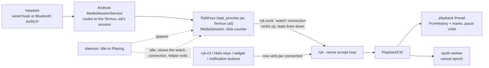
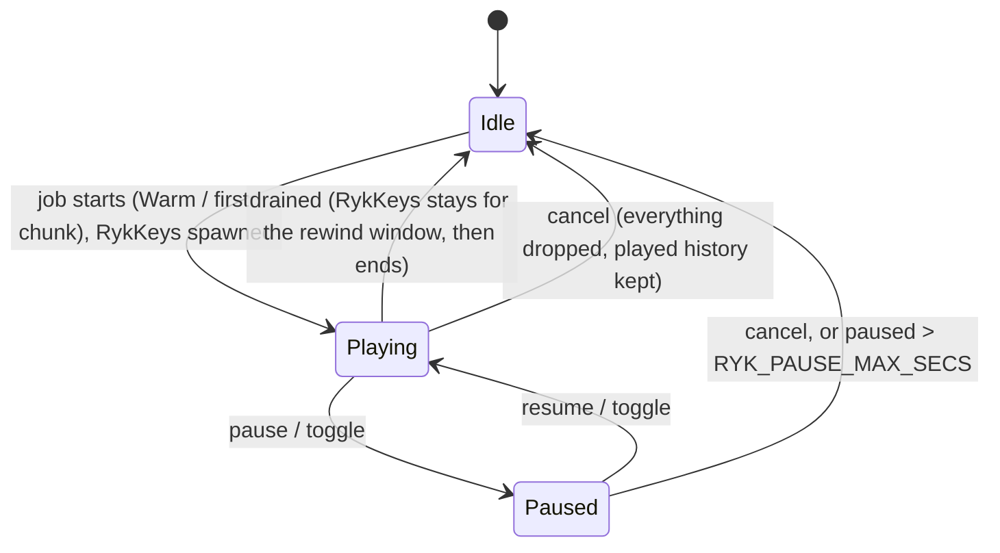

# Headset-button control of a running ryk session (pause and back one sentence on the headset; cancel from `ryk-ctl`)

| Field | Value |
|---|---|
| Date | 2026-10-23 (updated 2026-10-24) |
| Status | Phases 1-4 written. The Android side (keys, click counting, mapping, `--headset-check`, build on first use) is **verified on the S10e**. The release binary is built, and a **wired headset has been tried live** against `ryk --serve` (pause, resume and back work, user report 2026-10-24); the rest of "First live run" (XM4 through the helper, cancel tone, stage-2 cancel, notification) is still open |
| Builds on | `docs/rewind-plan.md` (playhead + sink restart); amends it in five places (below) |
| Sibling | `~/.config/helix/bin/TdAlarm.java` (td's reminder alarm): same mechanism, kept separate (see "Relationship to TdAlarm") |
| Scope | `src/lib.rs` `StreamPlayer`, `src/serve.rs`, a new `app_process` jar `RykKeys`, and the `ryk-skills` repo (`ryk-ctl`, `ryk-rewind`) |
| Device | Galaxy S10e (SM-G970U), Android 12 (SDK 31), Termux and Termux:API from F-Droid-signed APKs |

---

## TL;DR

1. **Without a helper, a headset button cannot reach ryk.** Android 12 routes media buttons to an app with a `MediaSession`; ryk's audio comes from `pacat` in Termux's UID, and Termux has no `MediaSession`. Termux:API's `--type media` notification does not create one either (checked in its source).
2. **No APK is needed.** `TdAlarm.java` already shows the trick: a jar run by `/system/bin/app_process` *as the Termux uid*, built on the phone with `ecj` + `dx`. The same recipe creates a `MediaSession` owned by `com.termux`, and **a media key dispatched while `pacat` played reached its callback in ~1 ms** (verified, below). Because the helper *is* the Termux uid it talks to `ryk.sock` directly: **no TCP port, no token, no `RUN_COMMAND` permission, no silent `AudioTrack`.**
3. The helper, `RykKeys`, lives only while ryk is live: the daemon starts it when a job starts and ends it a *rewind window* (default 10 min) after ryk's last audio. **v1 rule: close Apple Music (and any other media app) before using ryk.** While the helper lives, ryk owns every media button; there is no hand-off to other apps (deferred, see "Alternatives").
4. On the ryk side, **pause / resume / back one sentence / cancel** become four controls on the playback thread; the headset drives pause and back, cancel comes from `ryk-ctl`. They need the playhead and PCM history from `rewind-plan.md`, plus sentence marks (every `push` is already one sentence).
5. A measurement changes the old plan: audio handed to `pacat` runs **~0.87 s ahead of what is audible** (64 KiB pipe); shrinking the pipe to 4 KiB makes it **~0.23 s**.
6. **Keep `TdAlarm` and `RykKeys` as two separate jars** (same recipe, different lifecycle and repo). They coexist (checked); the interaction rules are in "Relationship to TdAlarm".
7. Default mapping (**Option A, chosen by the user**), from what the XM4 actually sends: **double tap (the XM4's play/pause gesture) = toggle** (pause when playing, resume when paused, by *ryk's* state, not the headset's); **a swipe either way (`NEXT` / `PREVIOUS`) = rewind one sentence**, and repeating the swipe walks back further. On a wired headset: 1 click = toggle, 2 or more = rewind. **Cancel is not on the headset**: `ryk-ctl cancel` (a Helix key such as `A-x`, a widget, a notification button). Long-press is not available (the system keeps it for the voice assistant). Observed: **a single tap sends nothing**.
8. **Priority is rewind** (the user's most-wanted control), so it is built first (Phase 1), keeps working after speech ends (the *rewind window*), and gets the easiest gesture after pause: the double tap.

---

## Findings

### 1. How a headset button is routed (Android 12)

| Fact | Status | Source |
|---|---|---|
| On Android 8+, the system "tries to find the last app with a MediaSession that played audio locally. If the session is still active Android sends the event directly to it", else to a manifest media button receiver, else drops it | Documented | [Responding to media buttons](https://developer.android.com/media/legacy/media-buttons) |
| Button-session selection walks audio-playback UIDs ("the lastly played app"); a UID with no media session is skipped | Read in AOSP `android12-release` | [`MediaSessionStack.java`](https://github.com/aosp-mirror/platform_frameworks_base/blob/android12-release/services/core/java/com/android/server/media/MediaSessionStack.java) |
| ryk's sound is played by PulseAudio's OpenSL player, which runs as the Termux uid. That uid has no `MediaSession` today, so it is skipped and the press goes to whatever else played last | Follows from the rows above | this repo |
| `termux-notification --type media` only adds four notification buttons that run shell commands. No `MediaSession` | Read in source | [`NotificationAPI.java`](https://github.com/termux/termux-api/blob/master/app/src/main/java/com/termux/api/apis/NotificationAPI.java) |
| Wired 1-button headsets send raw `KEYCODE_HEADSETHOOK` / `MEDIA_PLAY_PAUSE`; Android 12 forwards raw down/up events and does not turn double/triple clicks into Next/Previous, so the receiver counts clicks | Read in AOSP (excerpt) | [`MediaSessionService.java`](https://github.com/aosp-mirror/platform_frameworks_base/blob/android12-release/services/core/java/com/android/server/media/MediaSessionService.java) |
| Many Bluetooth earbuds resolve double/triple taps in firmware and send one finished `NEXT` / `PREVIOUS` | Vendor reports | [Podcast Addict FAQ](https://podcastaddict.com/faq/650) |
| Long-press on those keys goes to the voice assistant | Read in AOSP | `MediaSessionService.java` |

### 2. The existing `TdAlarm` pattern (what the phone already proves)

`~/.config/helix/bin/TdAlarm.java` is **not an app**. `td install` compiles it with `ecj` + `dx` into `~/.cache/td/td-alarm.jar`, and `bin/td` runs it as `CLASSPATH=... /system/bin/app_process -Xnoimage-dex2oat / TdAlarm set|cancel ...` with `LD_PRELOAD`/`LD_LIBRARY_PATH` removed. It runs as the Termux uid (`u0_a325`) and reaches `IActivityManager` / `IAlarmManager` by reflection, passing `com.termux` as the package. Its design doc records it firing on time with the screen off. That is exactly the identity ryk needs: **the uid that plays ryk's audio is the uid the helper runs as.**

Two assumptions from the first draft of this design turned out to be wrong:

- *"A helper can't share Termux's UID."* True for an APK (Termux is signed with the F-Droid key, `22:8F:B2:CF:...:D4:1C:42`), irrelevant for an `app_process` jar.
- *"There is no `android.jar`."* Termux's `ecj` wrapper already passes `-cp $PREFIX/share/java/android.jar`, so no download and no `aapt2`/`apksigner` are needed.

### 3. Spike results (on this phone, 2026-10-23)

Spike code: `tools/headset-spike/MediaSpike.java` (throwaway). Built exactly like `td install` builds `TdAlarm`.

| Test | Result |
|---|---|
| Create a `MediaSession` as `com.termux` from an `app_process` jar | **Works.** `active=true`. Needed three hidden-API steps by reflection: `ActivityThread.initializeMainlineModules()`, `systemMain()` + `getSystemContext()`, and a `ContextWrapper` that reports package `com.termux` and builds `MediaSessionManager(ctx)` itself |
| Dispatch `KEYCODE_MEDIA_STOP` while `pacat` plays, from a second process | **Delivered to the session's `onMediaButtonEvent` in ~1 ms** (down and up). Any Termux-uid process can dispatch a media key (`ISessionManager.dispatchMediaKeyEvent`), so the bridge can be tested end to end with no headset |
| Same, with no audio playing and no competing session | Also delivered (a fresh active session is the button target when nothing else is alive) |
| Startup | Session active **0.33 s** after launch (`TdAlarm` takes ~1.1 s per call) |
| Memory while alive | **RSS 126 MB, PSS 64 MB, 14 threads**, idle CPU ~0 after startup. This is why the helper only lives while ryk is active |
| Coexistence | Ran the real `td tick` (it executes `TdAlarm set`, 1.4 s) while a session was alive: the key still arrived afterwards, and td was still armed for its next reminder |
| An uncaught exception in the helper | Android's `RuntimeInit` handler turns it into a **silent SIGKILL** ("Killed", no message). The helper must catch `Throwable` in `main` and print it. This happened twice while writing the spike |
| **Real headset, Apple Music playing** (user run, `run.sh 60`) | **Keys reached the Termux-uid session**: `MEDIA_PREVIOUS` x3 (at +0.1 s, +2.0 s, +2.4 s) and `MEDIA_PAUSE` (+4.8 s), each a DOWN then UP 27-56 ms apart. All four have `eventTime=0, downTime=0, deviceId=-1, source=0`, which is what `new KeyEvent(action, code)` produces: synthesized by the Bluetooth AVRCP stack, not by an input device (a wired headset would carry a real device id and timestamps). The user confirmed the test headset is **Bluetooth**, so these are **already-resolved keys** (`PAUSE`, `PREVIOUS`), not raw `HEADSETHOOK` clicks. |
| **Unresolved: Apple Music also paused** | The user reports that pressing pause **also paused the Apple Music track** while the spike held the session. The spike did receive that `PAUSE`, and Android hands a media key to a single session, so Apple Music was not paused by our dispatch path. Candidates: (a) the headset/BT stack acts on the A2DP stream or the "addressed player" itself; (b) Apple Music reacts to the A2DP stream being suspended; (c) a Samsung layer. No `PREVIOUS` effect on Apple was reported. **Accepted by the user:** Apple Music is never played together with ryk, so Apple also pausing is harmless. The v1 rule (close Apple Music before using ryk) makes this moot. |
| **Real headset, Apple Music closed** (user run 2, `run.sh 60`) | Eight events, two rounds of the **same sequence `PAUSE`, `PLAY`, `NEXT`, `PREVIOUS`**, 4-5 s apart, each exactly one DOWN/UP pair, same synthesized shape as run 1. **No bursts**: no gesture produced several events close together, so the Sony resolves multi-taps in firmware and Bluetooth needs **no click counting**. **`PAUSE` then `PLAY` while the session said `PLAYING` all along**: the headset alternates the two by its own state, regardless of ours. **Round 1 was with the screen on, round 2 with the screen off (user): the same four events arrived both times, so the screen-off case works.** The user did not note which gesture produced which event |
| **Which gesture gives which key** (user-annotated plain run, screen on and off) | **double tap -> `MEDIA_PAUSE`; triple tap -> `MEDIA_PLAY`; swipe forward -> `MEDIA_NEXT`; swipe back -> `MEDIA_PREVIOUS`; single tap -> nothing** (the user is "pretty sure" it was not recorded). One later `PAUSE` is unannotated. This matches the XM4 using the *double tap* for play/pause (the first draft assumed a single tap). It is not yet known whether the triple tap really sends `PLAY` or the headset simply alternates `PAUSE`/`PLAY` by its own state (a second double tap would also give `PLAY`); the design does not depend on it, because `PAUSE` and `PLAY` are one "tap" to the helper. `run.sh 75 guided` (double tap twice, triple tap, single tap, swipes, swipe-and-hold) settles it |
| **Real wired headset** (user run, `run.sh 60`, 2026-10-24) | One button, and **every click is a `KEYCODE_MEDIA_PLAY_PAUSE`** (85, not `HEADSETHOOK`) with `scanCode=164, deviceId=11, source=0x101, flags=0x8` and real `eventTime`/`downTime`, as predicted for an input device. One click gave one DOWN/UP pair; a double click two pairs 213 ms apart; a triple click three pairs 285 and 220 ms apart. **The DOWN and the UP of a click arrive together, at the release** (same `eventTime`; `downTime` is the real press, 96-199 ms earlier), so a click's arrival time is its release time and the helper's click window runs from release to release. Nothing is resolved by Android: no `NEXT`, no `PREVIOUS`, so the click counter in `RykKeys` is what turns two clicks into `back` |
| **Replay of that wired run** (scratch script on `chain-test.py`'s fake daemon; real helper, real key routing) | 1 click -> `toggle`; 2 clicks 213 ms apart -> `back`; 3 clicks 285 ms apart -> `back` (one verb, not two); 2 clicks 330 ms apart -> `back`; **2 clicks 400 ms apart -> `toggle`, `toggle`** (two separate taps). With `RYK_KEYS_CLICK_MS=450` the 400 ms double click -> `back`. The slowest recorded gap (285 ms) leaves about 65 ms of margin under the 350 ms default |
| **Wired headset against the real daemon** (user report, 2026-10-24) | Pause, resume and back (rewind) "work very well". Cancel, the cancel tone, back after the speech ended and the notification were not part of that report |
| **Not tested** | Samsung quirks; a 3-button wired remote; a USB-C headset |

### 4. How far ahead of the speaker is the writer? (measured)

A 4 s tone was fed through `pacat` with ryk's exact flags and 100 ms writes, and `pacat`'s exit was timed after the last write returned:

| Pipe size | Audio still unheard when the last write returned |
|---|---|
| 64 KiB (today) | **0.87 s** |
| 4 KiB (`fcntl(F_SETPIPE_SZ)`, accepted by this kernel) | **0.23 s** |

PulseAudio reported a 165 ms stream buffer and a 125 ms configured sink latency, so the 64 KiB pipe (0.68 s of f32 at 24 kHz) is most of it. `rewind-plan.md` assumed 100 ms.

---

## Goals and non-goals

**Goals**

- From the headset, phone locked: pause, and jump back one sentence (or more, by repeating). Cancel the whole running session (current text and everything queued behind it) from the keyboard or phone, not the headset.
- Controls reach the *running* `ryk --serve` quickly (after the click window on wired headsets).
- No re-inference for pause and back. Cancel really stops compute (`docs/battery-and-heat.md`: wasted synthesis is the cost to avoid).
- When ryk is not live (no helper), the headset behaves exactly as before. While it is live, ryk owns all media buttons, so other media apps should be closed.

**Non-goals:** fast-forward past un-synthesized text, scrubbing, volume keys, replacing `pacat` as the sink.

---

## Design

### Architecture



- **Lifetime = arming.** On Idle -> Playing the daemon starts `RykKeys` (`app_process`, argv = socket path). The helper then stays for the **rewind window** after ryk's last audio (`RYK_REWIND_WINDOW_SECS`, default 600) so `back` still works after speech has ended; when the window ends the daemon closes the `watch` connection and the helper exits on EOF. Daemon crash or `silence` (`killall -9 ryk pacat`) also closes the socket, so the helper exits within a second and never lingers at 64 MB.
- **One verb set, one socket.** The headset, `ryk-ctl`, Helix keys and widgets all use the same verbs on the same Unix socket; the headset's is just a long-lived connection. Same trust domain as `--send` (the Termux uid), so no token and no network port.

### Button mapping

The helper turns every input into one of two logical gestures, so the Sony and a wired headset share one mapping. A Bluetooth headset resolves taps in its firmware and sends finished keys; a wired one sends raw clicks that the helper counts (350 ms window after the last key-up).

| Gesture | Sony XM4 sends | Wired headset sends | Action |
|---|---|---|---|
| play/pause gesture (Sony: **double tap**) | `MEDIA_PAUSE` **or** `MEDIA_PLAY` (the Sony alternates them by its own state, see the headset notes; a single tap sends nothing) | `PLAY_PAUSE` x1 (observed; `HEADSETHOOK` on some headsets) | `toggle` by ryk's state: pause if playing, resume if paused, nothing if ryk is silent |
| rewind gesture (Sony: **swipe forward or back**) | `MEDIA_NEXT` or `MEDIA_PREVIOUS` | x2 or more | `back` (one sentence; while paused it also resumes, from the earlier sentence) |
| (none) | `MEDIA_STOP` (the XM4 does not send it; other headsets may) | | `cancel` |
| long press | not available | not available | the system keeps it for the voice assistant |

**Cancel is off the headset by choice.** The XM4 offers only a double tap (play/pause) and the two swipes as usable gestures, and the swipes are easy to hit by accident, so a destructive action on any of them would be a trap. Cancel is `ryk-ctl cancel`: a Helix key (`A-x` is free), a Termux widget, or a notification button (Phase 4). It still drops the whole session including everything queued, and played history is kept.

**Double tap toggles** (the user's choice). `PAUSE` and `PLAY` are the same "tap" to the helper, and it flips ryk's own state, so the Sony's alternation never matters: even when the headset has lost track (for example after a swipe resumed ryk), the next double tap still does what you expect. A rewind gesture also resumes a paused session (replays the previous sentence); `ryk-ctl resume` / a Helix key picks up exactly where it paused. The mapping is a small table in `RykKeys`' argv; pause-only behavior is one setting away (`RYK_KEYS_MAP=tap:pause`). A paused session that nobody resumes ends after `RYK_PAUSE_MAX_SECS` (default 600).

On a 1-button wired headset a single click pauses and two or more clicks rewind, counted by the helper; the single click waits out the ~350 ms window before it pauses. Bluetooth `PAUSE` arrives after the headset's own tap-resolution delay. The mapping is a small table read from `RYK_KEYS_MAP` (below). Three or more clicks do the same as two (one `back`, not one per extra click); to go back further, double-click again. On the user's wired headset the double and triple clicks measured 213 ms and 285/220 ms from one release to the next, inside the 350 ms window; a slower double click turns into two toggles, and `RYK_KEYS_CLICK_MS=450` gives it room. Cancel is silent like pause, so the daemon plays a short descending earcon on `cancel` (see "Earcon" below); `back` is audible by nature.

### Apple Music and other apps (v1: close them first)

Android delivers a media key to **one** session, so ryk's buttons cannot be separated from another app's by gesture. **Decision for v1:** the user closes Apple Music (and any other media app) before using ryk, and ryk owns every media button while its helper is alive. There is no hand-off to other apps.

Why this is enough:

- **Routing does not depend on it.** In the Phase 0 run Apple Music was playing and the Termux-uid session still received every key. Closing Apple Music is only about avoiding side effects, not about delivery.
- **The side effects are known and accepted.** With Apple Music running, a `PAUSE` also paused it (cause unknown, see section 3); with Apple Music closed there is nothing to start or stop.
- **No ownership table, no hand-off, no timer game.** The helper consumes every media key (`onMediaButtonEvent` returns true). With ryk idle inside the rewind window, `NEXT` or `PREVIOUS` = `back` (replays the last sentence and makes ryk live again), `STOP` = `cancel` with nothing to cancel (reply `err: nothing playing`, no sound), `PAUSE`/`PLAY` = nothing to toggle (same reply, no sound).
- **Outside the window** there is no helper, and the buttons go wherever Android sends them. One unverified edge: Android may fall back to the last app that handled media buttons, so a press after the window could start Apple Music again if it is installed and idle. That is the normal state of the phone, so it is not a regression.

**Rewind window.** `RYK_REWIND_WINDOW_SECS`, default **600** (matches `RYK_PAUSE_MAX_SECS`). It keeps both the helper and the PCM history alive after the last audio, independent of the 30 s `RYK_SINK_IDLE_MS`; the sink is respawned on `back` (~80-200 ms). It is bounded by the daemon's own idle exit (`RYK_IDLE_TIMEOUT`, default 1800 s), which must not be shorter than the window. Cost: ~64 MB for the helper (idle CPU ~0) and up to ~17 MB of PCM (180 s of f32).

**Deferred: hand-off.** If sharing the buttons with Apple Music is wanted later, the helper can release its session and re-dispatch the key with `ISessionManager.dispatchMediaKeyEvent`. `MediaSpike` already has a `handoff` mode for it (`tools/headset-spike/run.sh 30 handoff`, compiled but never run). It is not part of v1.

### Wired headset instead of Bluetooth?

Both work with this design; Bluetooth wins for rewind.

| | Sony XM4 (Bluetooth) | Wired (3.5 mm or USB-C) |
|---|---|---|
| Proven here | **Yes**: keys reached the session | **Yes**: keys reached the session (`PLAY_PAUSE` clicks), and pause, resume and back worked against the live daemon (user, 2026-10-24) |
| Gestures | double tap = play/pause, swipes = next/previous, single tap = nothing (observed); all arrive resolved as `PAUSE`/`PLAY`, `NEXT`, `PREVIOUS` | usually one button: raw clicks, counted by the helper; x1 waits a ~350 ms click window; long press belongs to the voice assistant |
| Rewind (the priority) | swipe either way = `back`, repeatable | two or more clicks |
| State desync (`PLAY` vs `PAUSE`) | possible, see the headset notes | none (raw toggle key) |
| Audio lag at the ear | + A2DP latency (~0.2-0.3 s typical, **not measured**) on top of the 0.23 s pipe lag | pipe lag only |
| Battery / heat | headset battery; the phone's radio stays on | USB-C digital headsets draw power from the phone |

Recommendation: either works. The 5-minute wired check has been done (`run.sh 60`, then the live daemon): see the wired rows in section 3. The one wired-specific risk is a slow double click, which is counted as two single clicks (two toggles) when its release-to-release gap exceeds the click window; see the risks table. With a 3-button wired remote the volume keys could in theory be claimed through a remote `VolumeProvider` on the session (untested, and it takes over volume while ryk is live), so it is not planned.

### Notes on the test headset (Sony WH-1000XM4)

The model was confirmed by the user. It is Bluetooth, so the headset resolves taps itself and `RykKeys` sees discrete keys; the raw-click counter is only for wired headsets. **Observed on the user's unit:** double tap -> `PAUSE`/`PLAY`, swipe forward -> `NEXT`, swipe back -> `PREVIOUS`, single tap -> nothing, triple tap -> `PLAY` (or an alternation, see section 3), all with the screen on and off. The first draft assumed single tap = play/pause; that was wrong. Android sees only the finished keys, so the mapping is done in `RykKeys` (`PAUSE`/`PLAY` = pause, `NEXT`/`PREVIOUS` = `back`) with no change on the headset. Things to know:

- **The Sony's play/pause gesture alternates `PAUSE` and `PLAY` by its own state, not ours** (the spike session said `PLAYING` throughout). So the gesture can arrive as either, and the helper ignores which: any `PAUSE`/`PLAY` flips ryk. Mirroring ryk's state into the session's `PlaybackState` is still done (lock screen, correctness) but is not what makes it work.
- **Wear detection and Speak-to-Chat also send `PAUSE`/`PLAY`** (Sony app settings), and with toggle semantics each one flips ryk. Taking the headset off while ryk plays pauses it, and putting it back on resumes it, which is useful. The bad case is taking it off while ryk is already paused: the stray `PAUSE` would resume speech into a headset that is not on your head. Speak-to-Chat would pause ryk whenever you talk and resume it afterwards. If either bites, turn the setting off in the Sony Headphones app (`RYK_KEYS_MAP=tap:pause` also removes the stray resume).
- **Swipe forward and back are separate keys but one action.** `NEXT` and `PREVIOUS` both rewind, so direction does not matter and a swipe can be repeated to walk back several sentences. The swipes are easy to trigger by accident while adjusting the headset; a stray rewind is harmless (a sentence repeats). Swipe-and-hold may send `FAST_FORWARD`/`REWIND` keys (untested; `run.sh 75 guided` checks), which could become "back 10 s".

### ryk side: controls on the playback thread

Control never goes through the `Job` queue or the PCM channel (same reasoning as `rewind-plan.md`).

```rust
enum Control { Pause, Resume, Toggle, Back, Cancel, Rewind(f32), Status }

struct PlaybackCtrl {
    pending: Mutex<VecDeque<(Control, mpsc::Sender<Outcome>)>>,
    state:   AtomicU8,   // Idle | Playing | Paused  (read by accept_loop's idle check)
    epoch:   AtomicU64,  // bumped by Cancel; synth compares against the job's epoch
}
```



**Sentence marks.** `PcmHistory` gets `marks: VecDeque<u64>`: the absolute start sample of each appended chunk. Every `StreamPlayer::push` is one sentence (`split_sentences` -> one `push` per spoken sentence in `Pipeline::speak`), so `append` records one mark. Marks older than `retain_from` go on compact. Unspeakable sentences produce no chunk and no mark.

**Audible position.** `audible = playhead - SINK_LAG`; `SINK_LAG` = 0.25 s once the pipe is shrunk (0.9 s otherwise).

**Pause.** `playhead = audible`; `kill_sink`; state `Paused`; stop writing. Nothing is re-synthesized. Synthesis stalls by itself: `Pipeline::speak` already waits once `buffered_secs() >= GOV_MAX_AHEAD` (20 s), so a pause costs at most ~20 s of lookahead plus the sentence in flight. (`buffered_secs()` is `queued - written` today; it must become `queued - playhead`.)

**Resume.** `spawn_sink`, then start at `s0` (the current sentence's start) if we paused within 2 s of it, else at `audible - 1 s`. The small replay re-establishes context and hides the sink-restart gap (~80-200 ms).

**Back (one sentence).** "Previous track" semantics:

- `s0` = greatest mark <= `audible`.
- If `audible - s0 > RYK_BACK_RESTART_SECS` (default 1.5 s): target `s0` (restart the sentence you are in).
- Else: the greatest mark < `s0` (the previous sentence). None retained: clamp to the oldest mark and report `at-start`.
- Then `kill_sink` + `spawn_sink` and play forward as normal. Repeated presses walk back one sentence each. Works while paused (it also resumes, from the earlier position) and just after a cancel (replays what was heard).

**Cancel.** Cancel stops the entire running session: the sentence being spoken, the rest of that text, and every job queued behind it (another `--send`, `speak-last-reply`, a Helix `A-r`). Bump `epoch`, set `end = audible`, drop the unplayed tail and drain `rx`, `kill_sink`, state -> `Idle`. `speak_job` captures the epoch at start and checks it at the top of each sentence loop, inside `wait_until_buffered_below`, and in `push` (a stale push returns a `Cancelled` error that `speak_job` treats as a clean stop). Every `Job` is stamped with the epoch at enqueue time and skipped at dequeue if it is older than the current one, so queued jobs die without a separate "floor". A client that is still streaming text into its connection gets the rest of its body read and discarded, so it never blocks or errors. Jobs sent *after* the cancel carry the new epoch and play normally. Played history is kept so an accidental cancel is undone with `back`. A cancel also reaches into the vocoder: `run_stage2` runs the plan through tract's `run_plan_with_eval` with a check of the cancel epoch before every node (Phase 4), so the sentence in flight stops within one op instead of after a few seconds.

**Earcon.** After a `cancel` that actually stopped something, the daemon plays a 160 ms falling two-tone (880 Hz then 587 Hz, 8 ms fades, peak 0.18, generated as f32, no assets). It goes to a sink of its own on its own thread, so the reply to the cancel does not wait for it and the engine's sink, history and state are untouched. `RYK_EARCONS=0` silences it; a cancel with nothing to cancel, and the `RYK_PAUSE_MAX_SECS` timeout, stay silent. **Dropped from the first sketch:** the "tick when `back` has nowhere to go". `back` at the very start still restarts the first sentence, which is audible on its own, and a `back` with nothing retained would need the daemon to make a sound for a request the helper cannot tell it came from a button.

**Daemon idle.** `accept_loop`'s `truly_idle` is `pending == 0 && !sink_live`. A paused session has no sink and may have no pending job, so it would idle-exit and lose the paused audio. `Paused` must count as busy, bounded by `RYK_PAUSE_MAX_SECS` (default 600), after which pause becomes cancel.

**Shrink the pipe.** In `spawn_sink`, after taking the child's stdin: `fcntl(fd, F_SETPIPE_SZ, 4096)` (`libc` is already a `tract` dependency; Linux/Android only; failure ignored). The writer wakes ~23x/s instead of ~1x/s per pipe-full, negligible next to inference. Lag drops 0.87 s -> 0.23 s, so pause/back/cancel stop where the user heard them. It is independent of the headset work and worth landing first.

**Wire protocol** (extends the allowlist in `rewind-plan.md`; `--send` headers unchanged):

```
pause | resume | toggle | back | cancel | rewind <secs> | status
-> ok <state> [<detail>]          e.g.  ok paused  /  ok playing back  /  ok idle at-start
-> err: nothing playing

watch                              first field `watch`: connection stays open, line-oriented both ways
-> ok
-> state idle|playing|paused       pushed on every change
<- pause | back | ...              verbs, each answered with ok/err
```

Control verbs require an empty body and never touch `pending`. A `watch` connection is served on its own thread so it never blocks the accept loop.

### `RykKeys` (the bridge jar, about 550 lines of Java)

| Piece | Job |
|---|---|
| `main` | catches `Throwable` and prints it (an uncaught exception is a silent SIGKILL); exits when the socket closes |
| Context setup | the three reflection steps proved in the spike (`initializeMainlineModules`, `systemMain`/`getSystemContext`, a `ContextWrapper` reporting `com.termux` that builds `MediaSessionManager(ctx)`) |
| `MediaSession` | `FLAG_HANDLES_MEDIA_BUTTONS`; `onMediaButtonEvent` hands the raw `KeyEvent` to the click counter; playback state mirrors the daemon's `state` lines (PLAYING / PAUSED) |
| click counter | `HEADSETHOOK` / `PLAY_PAUSE` clicks are counted (350 ms after the last key-up, `RYK_KEYS_CLICK_MS`): one click is a `tap`, two or more a `skip`. Keys that arrive resolved (`PLAY`, `PAUSE`, `NEXT`, `PREVIOUS`, `STOP`) pass straight through |
| mapping | `RYK_KEYS_MAP`, `gesture:verb` pairs over three gestures: `tap` (default `toggle`), `skip` (`back`), `stop` (`cancel`). Verbs: `pause resume toggle back cancel rewind none` |
| `check` | `RykKeys check` runs the hidden-API steps and prints one line each (exit 0/1); `ryk --headset-check` runs it |
| `Watch` | `AF_UNIX` client (`android.net.LocalSocket`) to `ryk.sock`; sends verbs, reads `state` lines |

No UI in v1 (a session with no notification adds nothing to the lock screen). On-screen control is an opt-in notification kept by the helper (`RYK_NOTIFY=1`, Phase 4) with Back, Pause/Resume and Cancel buttons that run `ryk-ctl`.

**Build and install** (same recipe as `td install`): the Java source is embedded in the `ryk` binary (`include_str!`). `ryk --serve` compiles it into `~/.cache/ryk/keys.jar` in the background at start-up (`ecj -nowarn` + `dx --dex`, about 2 s on the S10e), and again whenever the embedded source differs from the copy it was built from (`keys.src`). So there is no install step to forget (matching `fd5130e`, which removed `--install-assets`). The jar appears by an atomic rename, a failed build leaves `keys-build.log` and keeps headset control off with one warning, and missing `ecj`/`dx` says `pkg install ecj dx`; nothing else is affected. `RYK_KEYS_JAR` points at a jar of your own, which is then never rebuilt. `ryk --headset-check` builds if needed and runs `RykKeys check`, so an Android upgrade that breaks a hidden signature is a one-command diagnosis. `tools/rykkeys/build.sh` is only for working on the Java file.

---

## Relationship to `TdAlarm` (accounting, and whether to merge)

| | `TdAlarm` (helix repo) | `RykKeys` (this repo) |
|---|---|---|
| Mechanism | `app_process` jar as the Termux uid, hidden binder calls by reflection, package `com.termux` | the same |
| Build | `ecj` + `dx` -> `~/.cache/td/td-alarm.jar`, by `td install` | the same recipe -> `~/.cache/ryk/keys.jar`, on first use |
| Lifetime | one-shot per call, ~1.1 s | long-lived while ryk is active, ~64 MB PSS |
| Talks to | `AlarmManager`, `TermuxService` (to run `td-tick`) | `MediaSessionService`, `ryk.sock` |
| Owner / repo | `~/.config/helix` dotfiles (`td`, `tl`) | `kukuryku` (+ `ryk-skills`) |

**Decision: do not merge them.** They share a recipe and ~20 lines of reflection helpers (`service()`, `call()`), nothing else. Merging would make `td install` rebuild a jar that carries ryk code, tie a dotfiles repo's release to this repo's, and give td a long-lived JVM it does not need. Keep two jars, two repos; copy the *convention* (build recipe, launch command, `~/.cache/<tool>/`, an `--install`/`--check` step). If a third helper appears, extract a shared `Hidden.java` then.

**Making sure both work well** (checked unless marked):

| Concern | Status |
|---|---|
| Run at the same time | **Verified**: real `td tick` (-> `TdAlarm set`) while a session was alive; key still delivered; td still armed |
| Different Android services, no shared binder objects, same uid | By design; nothing to collide on. TdAlarm uses alarm request codes 7421/7422; RykKeys creates no alarms |
| **Wake lock.** `td-tick --alarm` ends with `termux-wake-unlock`, which per td's doc also releases a lock you took yourself with `termux-wake-lock` (Termux has one lock flag) | **Rule: ryk and RykKeys never use `termux-wake-lock`.** ryk relies on the open audio stream to stay awake, as `lib.rs` documents; a td alarm cannot take that away. Otherwise a reminder 15 s ahead would drop a wake lock held for speech |
| Reminder notification during speech | `termux-notification` and a `MediaSession` don't interact; a notification neither takes the media buttons nor pauses ryk. Not tested with sound on |
| Hidden-API fragility | Both break together on an Android upgrade (TdAlarm: `getIntentSenderWithFeature`, `IAlarmManager.set` with 13 args; RykKeys: the three steps above). Each gets its own check (`td install` runs a tick; `ryk --headset-check`) |
| Silent kill on exception | `TdAlarm.main` catches only `InvocationTargetException`; any other exception SIGKILLs the process (td then reports "exit -9"). A `catch (Throwable)` there would help; the helix repo is deliberately left unchanged. `RykKeys` has its own catch |
| `silence` (`killall -9 ryk pacat`) | Leaves no stray helper: the watch socket closes, `RykKeys` exits |
| Phantom-process killer / battery exemption | Termux already needs *Unrestricted* battery for td; the helper adds one short-lived child process |
| Helix keys | `config.toml` binds `A-r` to `ryk-rewind` and no other Alt key, so `A-p` / `A-b` / `A-x` for `ryk-ctl` pause / back / cancel are free |

---

## Alternatives considered

| Option | Verdict |
|---|---|
| Sideloaded APK helper with a silent `AudioTrack`, loopback TCP + token to the daemon (the first draft of this design) | **Superseded.** Needed an APK build/sign, an opt-in TCP port, a token and an arming protocol. Keep as the **fallback** only if a live Apple Music session beats the Termux uid on this phone, or Samsung blocks the fake-context trick |
| `termux-notification --type media` buttons only | Cannot receive headset buttons. **Kept as a free side-feature** once `ryk-ctl` exists |
| Tasker / MacroDroid / Key Mapper -> Termux | Not installed, unverified, and still needs the same routing; not needed now |
| App -> Termux via `RUN_COMMAND` | Unnecessary (the helper is already the Termux uid) |
| `sharedUserId="com.termux"` APK | Impossible (F-Droid signature); moot |
| Accessibility key capture | Sees wired jack keys only, not Bluetooth; broad permission; rejected |
| Helper **is** the audio sink (`AudioTrack`) | The "proper" Android design (exact playback clock, instant pause). **Deferred**: rewrites the sink path stabilized in `4ece158`; drops `pacat`/`ffplay` |
| `pactl suspend-sink` for pause | Possible zero-restart pause; unmeasured. Phase 1 experiment |

---

## Deltas to `docs/rewind-plan.md`

1. `SINK_LATENCY_SAMPLES = 2400` (100 ms) -> `SINK_LAG` **0.25 s** with the 4 KiB pipe (**0.87 s** without it).
2. `PcmHistory` gains `marks` (sentence starts); back-N-sentences and time rewind share one playhead move.
3. `Control` is not rewind-only: `Pause`/`Resume`/`Toggle`/`Back`/`Cancel`/`Status` use the verbs that plan reserved. Barge-in's `Flush` becomes `Cancel`, which keeps played history.
4. The code has moved on: `PlayerMsg::{Warm, Chunk}`, `queued`/`written` counters, `WRITE_SLICE` (the 100 ms quantum already exists), `GOV_MAX_AHEAD` in `Pipeline::speak`. `buffered_secs()` must be redefined against the playhead.
5. `accept_loop` idle logic must treat `Paused` as busy.
6. History lifetime is the **rewind window** (`RYK_REWIND_WINDOW_SECS`, default 600), not the sink idle-close. `rewind-plan.md` clears history when the sink idle-closes (default 30 s); here the sink may close and be respawned on `back` while the history stays. Raise `RYK_HISTORY_SECS` from 60 to 180 so `back` can walk about 15 sentences into a long reply (~17 MB of f32 PCM). The daemon idle timeout must not undercut the window.

---

## Risks

| Risk | Severity | Mitigation / check |
|---|---|---|
| Another media app (Apple Music) is open while ryk runs | Low | Not needed for delivery (Phase 0: keys arrived with Apple Music playing). v1 rule: close it first; a `PAUSE` may also pause it. Hand-off is deferred. A live Apple session beating ryk in some other state: fall back to the APK design |
| The real headset sends something unexpected | Medium | `run.sh` prints every `KeyEvent`; the mapping is data |
| Samsung / screen-off behavior differs | Medium | Run Phase 0 with the screen off |
| Hidden-API signature changes on an Android upgrade | Medium | `ryk --headset-check`; same exposure as TdAlarm |
| Helper exception -> silent SIGKILL | Low | `catch (Throwable)` + log file; found and fixed in the spike |
| 64 MB while ryk is active | Low | Only while active; exits on EOF |
| Wired single-click pause feels laggy (350 ms window) | Low | shorten the window; Bluetooth unaffected |
| A wired double click slower than the window (release to release) counts as two single clicks: pause, then resume, and no rewind | Low | measured gaps were 213-285 ms against 350 ms; `RYK_KEYS_CLICK_MS=450` (a single click then waits 450 ms); confirmed by replaying 400 ms gaps |
| `SINK_LAG` is wrong for `ffplay` or when the writer isn't blocked | Low | error bounded by a few hundred ms; calibrate per sink |
| Cancel inside `run_stage2` is a per-node check in `src/tract_backend.rs` that was written without a compile | Medium | modeled on the existing `profile_run` hook; it compiled in the first release build. The live check is item 9 of "First live run": a cancel mid-vocoder should log `job cancelled` within a fraction of a second |
| A job arrives in the ~100 ms after the daemon hung up on the helper at the end of the window | Low | `Keys::ensure` still sees the old process alive, so that one utterance has no headset control; the next job starts a fresh helper |

---

## Plan

**Phase 0: the test headset (done for the main gestures; one optional run left).** Done: delivery with Apple Music playing and closed, screen on and off, key per gesture (section 3). Optional, about 65 s: `tools/headset-spike/run.sh 75 guided`, which prompts for double tap twice, triple tap, single tap, swipe forward/back and swipe-and-hold, and prints the key each produced. It settles whether the triple tap really sends `PLAY` and whether holding a swipe sends `FAST_FORWARD`/`REWIND`. *Exit criterion met:* buttons arrive with the screen off. A wired headset was recorded and tried later (section 3).

**Phase 1: rewind first (Rust, testable without Android).** Rewind is the control the user wants most, so it ships before pause and cancel.
- `F_SETPIPE_SZ` in `spawn_sink` (land alone first; also helps the rewind plan).
- `PcmHistory` + playhead + sentence marks, with history kept for the rewind window (PR 1-2 of `rewind-plan.md`, plus delta 6).
- `Back` (previous-track rule) and `Rewind(secs)` verbs, `ryk-ctl back` / `ryk-ctl rewind`, working while speaking, while paused and after speech has ended. Usable at once from Helix (`A-r`, `A-b`) or the shell, with no Android code.
- Then `PlaybackCtrl`, `Pause`/`Resume`/`Cancel`, epoch, paused-is-busy, `buffered_secs()` against the playhead.
- Fake-sink tests: back at 0.5 s into a sentence goes to the previous one, at 2 s restarts the current; back after the last sentence has finished replays it; back 3 times walks 3 sentences; pause then resume replays <= 1 s and loses nothing; cancel stops synthesis at the next sentence boundary, drops queued jobs (two jobs queued, cancel during the first: neither plays; a job sent after the cancel does) and `back` still replays; a paused session survives the idle timeout; protocol cases (`pause`+body is an error; unknown verb).
- Usable at once from Helix (`A-p`, `A-b`, `A-x`), a Termux widget, or `termux-notification --type media`.

**Phase 1 status (2026-10-24): written and tested in pieces; "First live run" below is the end-to-end check.**

- **Where:** `src/playback.rs` (new: `PcmHistory`, `Engine`, `Session`, `Handle`, `Config`), `src/lib.rs` (`StreamPlayer` runs a `Session` in daemon mode; `ProcFactory`/`ProcSink` spawn the real `pacat`/`ffplay` and shrink the pipe with `F_SETPIPE_SZ`), `src/serve.rs` (control verbs on the socket, jobs stamped with a cancel epoch, `busy()` keeps a paused or rewindable daemon alive), `src/tract_backend.rs` (`speak` checks for a cancel between sentences and before stage 2), `ryk-skills/bin/ryk-ctl` and `ryk-rewind`.
- **Differences from the sketch above:** a `Condvar` queue replaces the `sync_channel` so a control wakes the playback thread at once (no polling); a cancel leaves the playhead at the end of the sentence being heard, so `back` replays that whole sentence; the `status` verb exists; one-shot `ryk TEXT` is unchanged (no history, no controls).
- **Tested:** 37 unit tests in `playback.rs` with a fake sink (pause, resume, back, rewind, cancel, window, sink idle, spawn failure, cancel waking a blocked push), 4 for the wire parser, pipe-size and lag helpers; 25 repeated runs without a flake. `tests/real_sink.rs` (ignored by default) drove the real `pacat` with a synthetic tone: pause killed the sink in 3 ms and moved the playhead back by 0.23 s, toggle respawned it, `back` and `cancel` worked, and a cancelled job could not push.
- **Measured:** a 4 KiB pipe gave 0 underruns in 20 s with 3 busy CPU loops (the detector does fire when the feeder is starved), same as 16 KiB, so 4096 stays the default (`RYK_SINK_PIPE_BYTES`).
- **Build note:** debug builds of the vendored tract are too heavy for the phone, so the crate is built with `cargo build --release` only. The checks in "First live run" below are the first end-to-end run of the daemon with the model.

**First live run** (after `cargo build --release`):

1. `ryk --serve -v &` then `ryk --send "One. Two. Three. Four. Five."` (a longer text is better) and, while it speaks, `ryk-ctl pause`, `ryk-ctl toggle`, `ryk-ctl back` (twice), `ryk-ctl status`.
2. `ryk-ctl cancel` mid-text, then `ryk --send "after"`: the new text must play, and `ryk-ctl back` must replay the sentence you cancelled in.
3. Send two texts, `ryk-ctl cancel` during the first: neither continues.
4. Let it finish, wait 40 s (past the 30 s sink grace), `ryk-ctl back`: the last sentence replays.
5. `ryk-ctl pause` and wait: the daemon must still be there after `RYK_IDLE_TIMEOUT` would have passed (try `RYK_IDLE_TIMEOUT=30`).
6. Listen for clicks at each restart, and for gaps between sentences (the 4 KiB pipe); if there are any, try `RYK_SINK_PIPE_BYTES=16384`.
7. Headset (needs `pkg install ecj dx`; close Apple Music first): `ryk --headset-check` should print five `ok` lines and `headset check: OK`. Then start `ryk --serve -v`: the log says `headset control on; building ...` (first time only) and `headset helper built in ~2s`. `ryk --send` a long text with the XM4 on: `pgrep -f RykKeys` shows one process about a second after the text starts and `cat ~/.cache/ryk/keys.log` shows `session active`. Then: double tap pauses, double tap resumes, a swipe goes back a sentence (twice walks back two), a swipe while paused resumes from the earlier sentence. After the text ends, a swipe within the rewind window replays the last sentence. With `RYK_REWIND_WINDOW_SECS=20` the helper should be gone about 20 s after the last sentence (`pgrep -f RykKeys` empty, the log ends with `daemon closed the connection`).
8. `ryk-ctl cancel` mid-sentence: you should hear a short falling two-tone about a third of a second later, quiet next to the speech. Too loud, too quiet or annoying: `RYK_EARCONS=0`, or change the level in `cancel_earcon()` (`src/playback.rs`).
9. Stage-2 cancel: `ryk -v --send` a long paragraph, then `ryk-ctl cancel` within the first second. `top` should show the CPU fall at once, and the log `job cancelled` (before: after the current sentence's vocoder, a few seconds later). Send new text right after; it should start without waiting for the old sentence.
10. Optional notification: `RYK_NOTIFY=1 ryk --serve -v`, `--send` a text; a "ryk" notification with Back / Pause / Cancel should appear, change to Resume when paused, and disappear when the helper exits. Tap each button.

**Phase 2: `watch` + spawn (2026-10-24): written; the Android half is verified on the phone, the daemon half is tested with stubs.**

- **Where:** `src/control.rs` (new: the verb parser shared with the one-shot path, `control_reply`, and `serve_watch`), `src/headset.rs` (new: `Keys::ensure` launches the helper), `src/playback.rs` (`Status` gained `unplayed`/`held` and a change counter; `Handle::{snapshot, wait_change, nudge}`), `src/serve.rs` (a `watch` header goes to `serve_watch`; the worker calls `keys.ensure()` before each job), `tools/rykkeys/{RykKeys.java, build.sh, chain-test.py}`.
- **`watch` on the wire:** `ok`, then `state idle|playing|paused` first and on every change; the client sends the same verbs as lines and gets `ok ...` / `err: ...` back. A job in progress (`hold`) counts as `playing` even between sentences. The daemon hangs up when the state is idle, nothing can be replayed and nothing is queued (the rewind window is over): that EOF is the helper's cue to exit. Two detached threads per connection (state pusher, verb reader); a client that stops reading is cut off after 5 s; lines over 4 KiB end the connection.
- **Spawning:** `Keys::ensure` runs on the worker thread when a job starts. It does nothing when the helper is alive, when `RYK_HEADSET=0`, off Android (no `/system/bin/app_process`), or while `~/.cache/ryk/keys.jar` is missing (one hint in the log; the jar is picked up as soon as it appears). A helper that exits cleanly (the daemon hung up) is simply started again by the next job; one that crashes three times in a row within 10 s is not tried again. Output goes to `~/.cache/ryk/keys.log`.
- **`RykKeys` (first version):** the session (spike recipe), the key map (`PLAY`/`PAUSE`/`PLAY_PAUSE`/`HEADSETHOOK` -> `toggle`, `NEXT`/`PREVIOUS` -> `back`, `STOP` -> `cancel`, everything else consumed and ignored), one verb per key-down (repeats and key-ups ignored), and `state` lines mirrored into `PlaybackState`. Exit 0 when the daemon goes away, 1 on its own failure.
- **Tested:**
  - **Rust** (scratch crate, no tract; `playback.rs`, `control.rs`, `headset.rs` and `serve.rs` compiled against hand-written stubs of `kokoro`/`tract_backend`): 76 tests, 40 consecutive runs without a flake. New: status/wake-up semantics (audio pushed but not yet taken by the playback thread counts as `playing`, which a stress run showed a watcher could otherwise miss), `watch` handshake, verbs, errors, over-long line, hang-up frees the threads, window end closes the connection, a queued job keeps it open, spawn/respawn/give-up/log/drop-kills with real child processes. This also typechecked `serve.rs`, before the first release build of the real crate.
  - **Android** (`python3 tools/rykkeys/chain-test.py`, 22 s, no headset): the helper with no daemon exits 0; with a fake daemon it connects, sends `watch`, creates its session, and real keys dispatched through `ISessionManager` arrive as `STOP`->`cancel`, `PAUSE`/`PLAY`/`PLAY_PAUSE`/`HOOK`->`toggle`, `NEXT`/`PREVIOUS`->`back`, `FAST_FORWARD`->nothing; `state` lines are read; it exits 0 when the daemon hangs up.
- **Not tested:** the real daemon with the helper (needs the release build); a real headset through this helper (the spike covered the headset, the chain test covers the helper). *Update 2026-10-24:* the release build exists and a wired headset has since driven pause, resume and back on the real daemon; the XM4 through the helper has not been reported yet.

**Phase 3: finish `RykKeys` (2026-10-24): written. Android side verified on the phone; the daemon half tested with stubs.**

- **Click counter and mapping** (`tools/rykkeys/RykKeys.java`): described above. `chain-test.py` now presses `HOOK` and `PLAY_PAUSE` one, two and three times in a row and checks that exactly one verb arrives (`toggle` for one click, `back` for two or more), that resolved keys are not delayed, and that `RYK_KEYS_MAP=tap:pause,stop:none,skip:rewind` is obeyed. 44 checks, all passing, about 45 s.
- **Embedded source and first-use build** (`src/headset.rs`): `Builder` (compile, atomic install, `keys.src` stamp, build log), `Keys::prepare` (background build at start-up; `ensure` waits for it). Found by running the real tools: `dx` rejects an output name that does not end in `.jar`, so the temporary file is `keys.<pid>.tmp.jar`. On the phone: built in 1.7 s from a clean cache, the helper was started through `Keys` with the real jar, sent `watch`, mirrored `state playing`, and was gone 0.1 s after the connection closed.
- **`ryk --headset-check`**: `headset::check()` builds if stale and runs `RykKeys check` with the terminal attached. Run on the phone (through a scratch binary, before `ryk` itself had been built): Android 12 / SDK 31 / SM-G970U, all five steps `ok`, exit 0.
- **Earcon** (`src/playback.rs`): `cancel_earcon()` and `Config::earcon` (`RYK_EARCONS`). Tested for shape (length, peak, silent ends, falling pitch) and for behavior (own sink, async, history untouched, silent when disabled / nothing to cancel / pause timeout). The level (peak 0.18; speech peaks are higher) is a guess that has not been judged by ear yet; item 8 of "First live run" checks it.
- **Tested:** 92 tests in the scratch crate (`playback`, `control`, `headset`, `serve` against stubs) plus one ignored test that builds the real embedded source with the real `ecj`/`dx`; 25 consecutive runs without a flake.
- **Not done / not tested:** a wired headset (here the click counter was tested only with dispatched raw keys; a real jack headset was recorded and tried live afterwards, see section 3); swipe-and-hold keys (`FAST_FORWARD`/`REWIND` are consumed and ignored; `run.sh 75 guided` would show whether the XM4 sends them); `RYK_KEYS_MAP` is not validated by `--headset-check`.

**Phase 4: polish (2026-10-24): written. The helper side and the engine are tested; the stage-2 change compiled in the first release build but has not been exercised live.**

- **Fade-in after a restart** (`src/playback.rs`): the first slice written after `resume`, `back` or `rewind` goes through a 10 ms sin² ramp that starts at exactly zero, so starting in the middle of a waveform does not click. The history is never modified (a replay is bit-exact), a failed write keeps the fade for the retry, and plain playback is untouched. `RYK_FADE_IN_MS` (default 10, `0` = off). **Not possible:** a fade-out on pause. The 0.23 s still in the pipe cannot be reached, so the cut at the end of a pause stays abrupt; a pulse `cork` would fix it and is unmeasured. Neither has been judged by ear, so whether the fade-in is needed is a listening test (items 6 and 8 of "First live run").
- **Stage-2 cancel point** (`src/tract_backend.rs`): `Stage::run_cancellable` and `cancellable_run` run the plan with `run_plan_with_eval` and look at the cancel epoch before every node, ending the run with `Cancelled`; `run_stage2` uses it with `|| player.is_cancelled()`. This is exactly `SimpleState::run` (`runnable.run` is `SimpleState::new` then `run_plan_with_eval(inputs, eval)`) with a check in front of `eval`, copied from the shape of the existing `profile_run` / `nan_trace_run` hooks. Stage 1 (on the lookahead thread) is not interruptible; it is short. It was written without a compile (debug builds of the vendored tract are too heavy for the phone), so the first release build was its first compile; its live check is item 9 of "First live run". The cost is two atomic loads per node, noise next to the kernels.
- **Notification** (`tools/rykkeys/RykKeys.java`, opt-in): `RYK_NOTIFY=1` makes the helper keep a `termux-notification` (id `ryk`) while it lives: "Reading" / "Paused" / "Done. Back replays the last sentence.", with buttons Back, Pause or Resume, and Cancel; pinned while playing or paused, swipeable when idle; removed when the helper exits. Updates are coalesced on one worker thread (each call takes about half a second). The buttons run `ryk-ctl` by absolute path (`RYK_CTL`, else the first on `$PATH`) with `RYK_SOCKET` set to the daemon's socket, because Termux:API runs them in a bare environment where `ryk-ctl` would otherwise look in `/tmp` (found by running the command under `env -i`).
- **Tested:** `chain-test.py --notify` (51 checks): post, update and remove all exit 0 (`termux-notification-list` hangs without a permission, so what is on screen was not checked), and the Back button's command, taken from the helper's log and run under a bare environment, reaches a fake daemon as `back`. 97 tests in the scratch crate (5 new for the fade-in), 20 clean runs.
- **Not tested:** tapping the buttons, how the notification looks, the fade-in by ear, and the stage-2 cancel at run time.

---

## Resolved questions

1. ~~Layout~~ **Decided: Option A.** The XM4 has no single-tap gesture. Double tap (the headset's own play/pause) toggles pause/resume by ryk's state; a swipe either way rewinds one sentence; cancel is `ryk-ctl cancel`. (Option B, double tap = rewind and swipe = pause, was rejected: two taps per step back and a stray swipe would pause.) Optional check left: `run.sh 75 guided`.
2. ~~Cancel scope~~ **Decided:** cancel drops the entire running session, including everything queued. There is no separate "cancel current only" verb.
3. ~~Auto-start~~ **Decided:** the daemon starts `RykKeys` automatically when a job starts (no `RYK_HEADSET=1` opt-in). `RYK_HEADSET=0` stays available as an off switch. If `ecj`/`dx` are missing, one warning and headset control stays off.
4. ~~TdAlarm hardening~~ **Decided:** leave the helix repo and `TdAlarm.java` alone. `RykKeys` copies the conventions and shares no code.

---

## References

- Android: [Responding to media buttons](https://developer.android.com/media/legacy/media-buttons)
- AOSP `android12-release`: [`MediaSessionStack.java`](https://github.com/aosp-mirror/platform_frameworks_base/blob/android12-release/services/core/java/com/android/server/media/MediaSessionStack.java), [`MediaSessionService.java`](https://github.com/aosp-mirror/platform_frameworks_base/blob/android12-release/services/core/java/com/android/server/media/MediaSessionService.java)
- Termux: [`NotificationAPI.java`](https://github.com/termux/termux-api/blob/master/app/src/main/java/com/termux/api/apis/NotificationAPI.java)
- Field reports: [voice-agent #358](https://github.com/mjarco/voice-agent/issues/358), [androidx/media #1493](https://github.com/androidx/media/issues/1493), [Podcast Addict FAQ](https://podcastaddict.com/faq/650)
- `~/.config/helix/bin/TdAlarm.java`, `~/.config/helix/docs/exact-alarm-plan.md`, `td install` (`build_alarm`, `_run_alarm`) in `~/.config/helix/bin/td`
- This repo: `tools/headset-spike/`, `src/lib.rs` (`StreamPlayer`, `playback_sessions`, `write_counted`, `WRITE_SLICE`), `src/serve.rs` (`handle_conn`, `speak_job`, `accept_loop`), `src/tract_backend.rs` (`Pipeline::speak`, `GOV_MAX_AHEAD`), `docs/rewind-plan.md`, `docs/battery-and-heat.md`
