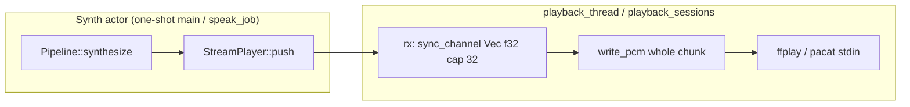
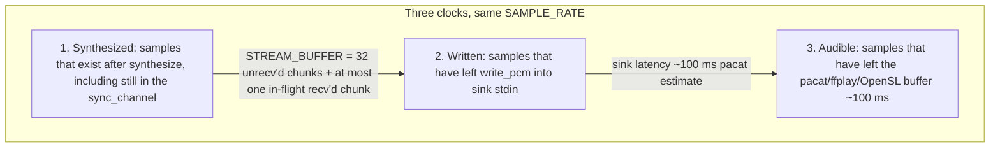
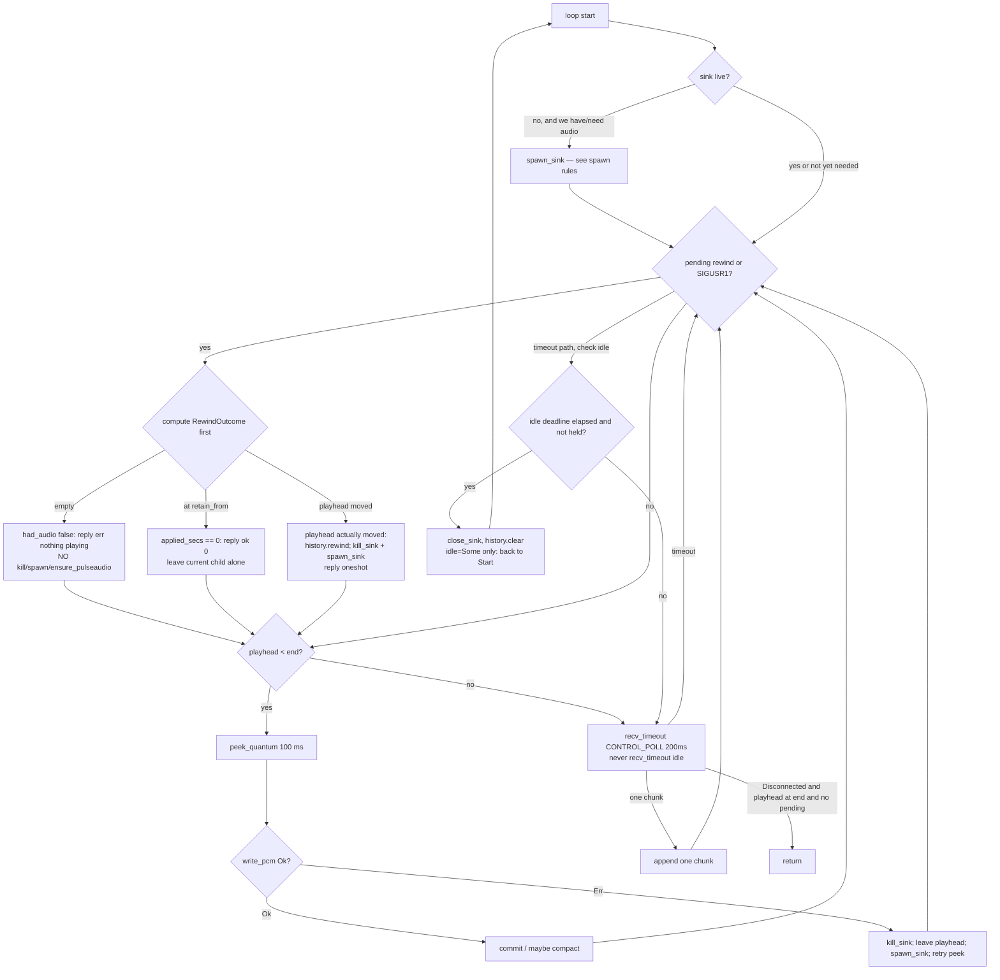
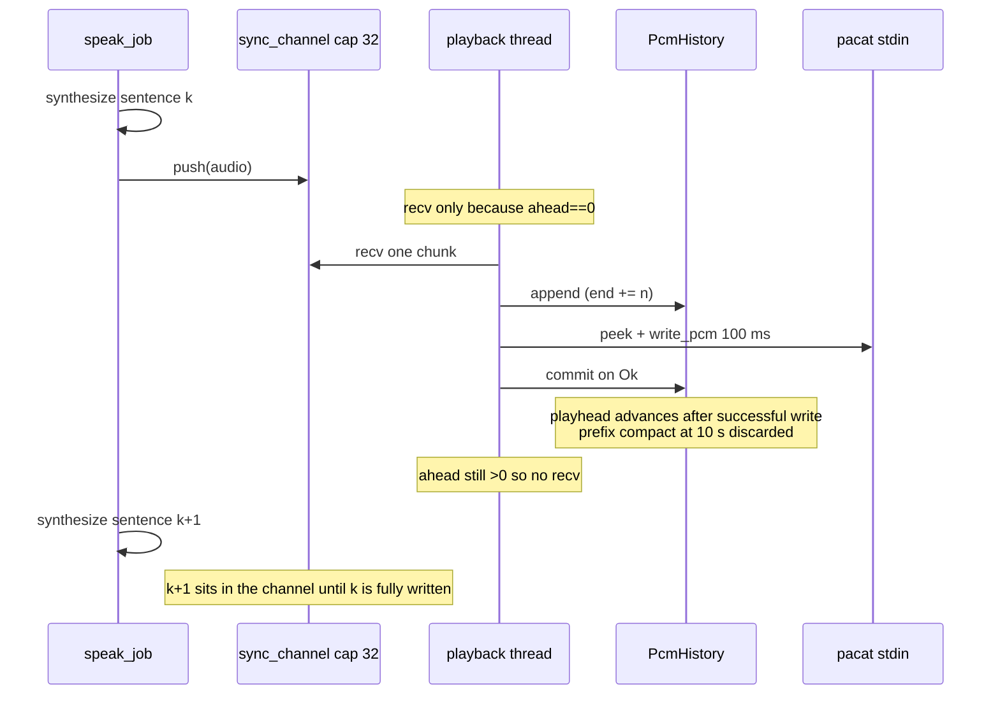
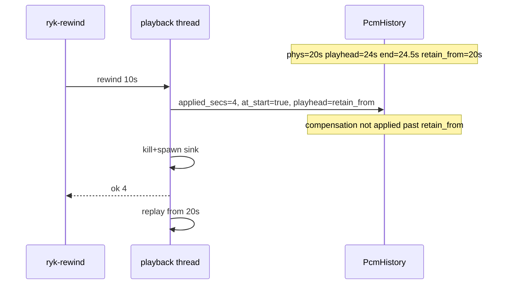

# Command-line rewind of already-played ryk audio (no re-inference)

| Field | Value |
|---|---|
| Author | (draft) |
| Date | 2026-09-21 |
| Status | Draft (control-plane revision: Helix / Grok / Claude poke, /rr, no `--rewind` flag) |
| Implementation | Built differently from this draft on 2026-10-24: `src/playback.rs`, `ryk-ctl` / `ryk-rewind`. See **Phase 1 status** in `docs/headset-control.md` for what changed (Condvar queue instead of polling, sink-idle no longer clears history, measured sink lag) |
| Scope | `ryk` TTS player (`src/lib.rs` `kokoro::StreamPlayer`, `src/serve.rs`, `src/bin/kokoro_tract.rs`) |
| Platforms | Termux/Android (`pacat` + PulseAudio OpenSL) and Unix desktop (`ffplay` or `pacat`) |

---

## Feasibility

### 1. Today: no

Rewind-from-CLI while playback is live is **not possible** with the current binary. The player is a one-way PCM pipe with no playhead, no retained samples, and no control plane that can interrupt a live sink.

Grounding in the code:

- `kokoro::StreamPlayer` (`src/lib.rs`) owns a `sync_channel::<Vec<f32>>(STREAM_BUFFER)` with `STREAM_BUFFER = 32` **sentence chunks**, not seconds. `push` sends a finished `Vec<f32>`; `playback_thread` / `playback_sessions` `recv`s it and immediately `write_pcm`s it to `ffplay`/`pacat` stdin. There is no store after that write. Samples that have left `write_pcm` cannot be un-written. `push` backpressure **is** the synth pacing: the playback thread only `recv`s the next chunk after `write_pcm` of the current one returns (`docs/ryk-cli-and-daemon.md`).
- `write_pcm` is a single `write_all` of the whole sentence chunk. A chunk is typically several seconds. Nothing inspects a control flag between samples.
- `build_sink_command` starts `ffplay` (`-f f32le -ar 24000 -ac 1 -i pipe:0`, `-probesize 32 -analyzeduration 0 -fflags nobuffer`) or `pacat` (`--raw --format=float32le --rate 24000 --channels=1 --latency-msec=100`). Neither pipe is seekable. There is no `ffplay -ss` / Pulse seek path, and `close_sink` only EOFs and `wait`s — it does not restart from an offset.
- One-shot (`idle = None`) **eager-spawns** the sink in `playback_thread` *before* the first `recv`, so Pulse/`ffplay` start overlap the first `synthesize`. The daemon (`playback_sessions`) waits for `rx.recv()` then spawns.
- One-shot `ryk TEXT` (`src/bin/kokoro_tract.rs`) compiles a `Pipeline`, `split_sentences`, then `prepare_or_skip` + `pipeline.synthesize` + `player.push` + `player.finish()`. No IPC, no control socket, no signal handler. The process is blocked in synth/playback. A second terminal has nothing to talk to.
- `ryk --serve` / `ryk --send` (`src/serve.rs`) speak a Unix socket protocol of **one utterance per connection**: header `voice\tlang\tspeed\n` + UTF-8 body to EOF. `handle_conn` always `parse_request`s a `Job` and `tx.send`s it to the synth worker. The client is fire-and-forget after `ok`/`err`. There is no `rewind` verb. The `StreamPlayer` is **moved into** `worker_loop`; the accept loop only has `Sender<Job>`, `pending`, and `sink_live`. Even a new job cannot seek: queue policy is FIFO (`docs/ryk-cli-and-daemon.md`), and barge-in (kill in-flight audio) is an explicit deferred follow-up. `send()` auto-starts `--serve` if needed and `connect_retry` polls for **20 s** (`Duration::from_secs(20)` in `src/serve.rs`), covering the one-time pipeline compile.
- Tract inference is the expensive part (mid-cluster RTF ~1.25 on the phone). Re-calling `Pipeline::synthesize` to "seek" is not a rewind; it is a re-render.

### 2. After the proposed change: yes, with constraints

Rewind becomes possible if `ryk` owns a replayable PCM store and **restarts the sink process**, then feeds from a moved playhead. Constraints:

| Constraint | Meaning |
|---|---|
| Window size | Rewind clamps to the oldest retained sample. Default step is 10 s; retained *already-played* history is larger (default 60 s, env-overridable). The store keeps already-written samples (up to the cap) plus the unwritten tail of chunks that have been `recv`'d. Chunks still sitting in the `sync_channel` stay there; they are already after the playhead and are **not** copied into history until `recv`. |
| Synth pacing | `STREAM_BUFFER = 32` remains the only lookahead bound. The playback thread `recv`s **one** chunk at a time, and only when `playhead == end` (the in-flight chunk is fully written). It does **not** drain the channel into history. |
| Daemon vs one-shot | v1 control talks to the live `--serve` Unix socket. Helix and `/spk` both `--send` into that daemon, so one player owns the sink. One-shot `ryk TEXT` has no listener; not the editor path. No TCP port. No `ryk --rewind` flag. |
| Sink spawn | One-shot still eager-spawns before the first chunk (preserve TTFA). Daemon still spawns on first ingested sample when `!sink_live`. A **moving** rewind is `kill_sink` + `spawn_sink`, not idle-close. Empty/`ok 0` rewind does not spawn. |
| Sink restart | The PCM pipe is not seekable. When the playhead actually moves, rewind `kill`s the current `ffplay`/`pacat` child and `spawn_sink`s a new one. Expect ~80–200 ms of gap/click on Termux when PulseAudio is already up; more if Pulse has idle-exited. No-ops (`!had_audio`, `applied_secs == 0`) do not kill or spawn. |
| Playhead vs already-written | The store's playhead is **next sample to write**. It advances only after `write_pcm` returns `Ok`. Audible audio lags written audio by the sink buffer (~100 ms is a `pacat --latency-msec=100` estimate, not a measured OpenSL number). Latency compensation is internal; the CLI ack reports user-facing seconds without it. |
| Control latency | `handle_conn` waits on a oneshot for `RewindOutcome`. Playback must observe pending rewind within one write quantum + one control poll (100–200 ms), **not** `RYK_SINK_IDLE_MS` (default 10 minutes). Idle waits are capped at `CONTROL_POLL` (200 ms, same as today's `HOLD_POLL`). |
| No re-inference | Rewind never calls `Pipeline::synthesize`, never touches tract GEMM/pinning, never re-phonemizes. If the requested 10 s is not in the store, we clamp; we do not go back to text/token offset. |
| Nothing playing | If history is empty (no utterance ingested, or history cleared after sink idle-close), the poke script exits non-zero with `err: nothing playing` and does **not** auto-start a daemon, **nor** `pacat`/Pulse/OpenSL. |

---

## Overview

`ryk` plays TTS by synthesizing sentence chunks and pouring f32le PCM into a child process over a pipe. Users want to skip backward ~10 seconds **while Helix or Grok/Claude `/spk` is speaking**, eyes-free, without looking at a TUI and without re-running Kokoro.

This design adds a capped PCM history with an explicit playhead inside the playback thread, a `StreamPlayer::rewind` API that kills and respawns the sink, and a backward-compatible control verb on the existing `--serve` Unix socket. The user-facing poke is **`ryk-rewind`** (a tiny script in `ryk-skills`, sibling of `speak-last-reply`) — **not** a `ryk --rewind` flag. Helix, Grok, and Claude Code all call that same script. Default step is 10 seconds. Inference is untouched. `STREAM_BUFFER` backpressure and one-shot eager spawn stay as they are today.

---

## Background & Motivation

### Current playback path



Relevant types and functions, all in `src/lib.rs` `pub mod kokoro` unless noted:

- `SAMPLE_RATE = 24000`, mono `f32`.
- `StreamPlayer { tx: Option<SyncSender<Vec<f32>>>, thread, sink_live: Arc<AtomicBool>, hold: Arc<AtomicBool> }`.
- `StreamPlayer::new()` — one-shot, `idle = None`. `playback_thread` calls `spawn_sink` **before** `rx.iter()`, so Pulse/`ffplay` start overlap the first `synthesize`.
- `StreamPlayer::with_sink_idle(idle)` — daemon, used from `serve()` with `RYK_SINK_IDLE_MS` (default `DEFAULT_SINK_IDLE` = 10 minutes). `playback_sessions` `recv`s the first chunk, *then* `spawn_sink`.
- `hold_sink` / `release_sink` — `speak_job` holds the sink across in-utterance synth gaps via `SinkHold` (`src/serve.rs`) so `playback_sessions` does not `close_sink` between sentences. `HOLD_POLL = 200 ms` while held; otherwise `recv_timeout(idle)`.
- `spawn_sink` / `close_sink` / `build_sink_command` / `ensure_pulseaudio`. On write failure, `playback_sessions` closes the sink and `continue`s the outer loop, which `recv`s a **new** first chunk — the failed chunk is dropped. (Rewind must not inherit that drop; see playhead-vs-write below.)
- `STREAM_BUFFER = 32` bounds **how many sentence chunks synth may queue ahead of the playback thread's `recv`**, not seconds of wall audio. That bound is the synth pacing contract.

Daemon path (`src/serve.rs`):

- `serve()` compiles `Pipeline` once, builds one `StreamPlayer`, moves it into `worker_loop`.
- Accept loop: `handle_conn` → `parse_request` → `Job { voice, lang, speed, text }` → `mpsc::Sender<Job>`.
- `speak_job`: `player.hold_sink()`, per sentence `prepare_or_skip` + `pipeline.synthesize` + `player.push`, then `SinkHold` drops → `release_sink`.
- Client `send()` writes `"{voice}\t{lang}\t{speed}\n"` + body, half-closes, reads `ok\n` / `err: …`. Auto-starts `--serve` if the socket is dead; `connect_retry` polls until the compile finishes (currently a **20 s** deadline).
- Socket path: `$RYK_SOCKET`, else `$XDG_RUNTIME_DIR/ryk.sock`, else `$TMPDIR/ryk-$USER.sock`, else `/tmp/ryk-$USER.sock`.

### Pain points

1. There is no way to hear the last 10 s again without re-sending the text (and re-paying tract, RTF ~1.25 on device).
2. Once PCM is written to the pipe it is gone from `ryk`. `STREAM_BUFFER` is lookahead the playback thread has **not yet `recv`'d**; it is not history.
3. Eyes-free control needs a poke into the process that already owns `pacat`. One-shot Helix `ryk` blocks the editor until `finish()`. `--send` can only enqueue *more* speech; rewind must not be a `Job`.

---

## Goals & Non-Goals

### Goals

- Rewind N seconds (default **10**) of currently playing audio **without re-inference**.
- Clamp at the start of retained history; no-op / `ok 0` if already there; `err: nothing playing` if there is no retained PCM.
- Work on Termux (`pacat` / Pulse / OpenSL) and desktop (`ffplay` or `pacat`).
- After rewind, the listener hears the last N seconds **again**, then the original continuation: the skipped-forward region still in the store, then any not-yet-`recv`'d channel chunks as they are ingested, then new synth.
- Eyes-free: Helix key / Termux widget / SIGUSR1 pokes the **already-playing** daemon. Not a sequential `ryk` mode, not a Grok model turn as the fast path.
- Preserve today's `STREAM_BUFFER` pacing and one-shot eager spawn (no TTFA regression).
- No new heavy crates. std `mpsc`, threads, `UnixStream`. `libc` stays the existing optional `tract` dep; rewind itself does not require it.
- Additive Unix-gated style, matching `--serve`. Silent-by-default; `-v` / `KOKORO_VERBOSE` logs rewind/restart.
- Do not change Kokoro/tract inference, GEMM, or CPU pinning.

### Non-goals (unless cheap)

- Full scrubber / waveform TUI / arbitrary seek UI.
- Fast-forward that skips *un-synthesized* future (would block on inference). Skipping already-synthesized lookahead is a later sibling of playhead math, not this RFC.
- Pause / stop / barge-in as user-facing features. Barge-in is already deferred in `docs/ryk-cli-and-daemon.md`. Rewind **shares the sink-kill path** barge-in will need; the control enum should leave a `Flush`/`Stop` slot so we do not paint over it.
- Re-synthesizing from a text or token offset.
- Windows named pipes (daemon is Unix-only today).
- Changing `STREAM_BUFFER`, sentence splitting, or markdown cleanup.
- Merging `playback_thread` and `playback_sessions` into one loop. They share helpers (`PcmHistory`, quantum write, `kill_sink`); unification is optional and not merge-blocking.
- A `ryk --rewind` flag, a TCP/HTTP control port, or a Grok/Claude slash command as the **fast** path (slash dispatch is an LLM turn; Grok TUI keys are not remappable).

---

## Proposed Design

### The three clocks

"Already played" is not one number.



| Clock | Where it lives today | After this change |
|---|---|---|
| Synthesized | `Pipeline::synthesize` output, then the `sync_channel` until `recv` | Still in the channel until `recv`; then `PcmHistory.end` |
| Written | forgotten after `write_pcm` | `PcmHistory.playhead` (next sample to write; advances only on `Ok`) |
| Audible | inside `pacat`/`ffplay` / OS, invisible to ryk | estimated as `playhead - SINK_LATENCY_SAMPLES` (~2400 samples). 100 ms is `pacat --latency-msec=100`, **not** a measured OpenSL figure |

A ring of *only* already-written samples that **overwrites** the 10 s we skip back over would delete the continuation: after replaying those 10 s there would be a hole, and filling it would require re-synth.

The hole argument does **not** require copying the whole `sync_channel` into the store. Samples still sitting in the channel are already after the write playhead; they will be `recv`'d in order once the playhead catches up. The store only needs:

1. already-written history (capped), and
2. the unwritten tail of chunks that have been `recv`'d but not fully written (at most one in-flight sentence chunk under the ingest policy below).

**Required structure:** one store of `[oldest retained played, end)` where `end` is last **ingested** sample, plus an explicit playhead. After rewind, playhead moves backward through (1); (2) remains in front of the new playhead; channel chunks remain in the channel. Oldest samples may drop only when they are **behind** the playhead *and* outside the retention window.

### Ingest policy (preserve `STREAM_BUFFER` pacing)

This is a Key Decision, not a loop-micro-optimization.

Today the playback thread `recv`s the next `Vec<f32>` only after `write_pcm` of the current chunk returns. That is the only thing that keeps a faster-than-realtime backend (desktop RTF ~0.5) from synthesizing the whole utterance into RAM. `STREAM_BUFFER = 32` counts **unrecv'd** chunks.

**Rule:** `recv` / `append` **one** chunk, and only when `ahead == 0` (`playhead == end`). Never `try_recv` the channel empty. Never `recv` during a rewind replay (`ahead > 0`).

Consequences:

- `PcmHistory.ahead` is at most one sentence chunk (the in-flight tail). Peak RAM is `played_cap` (default 60 s, 5.5 MiB) plus that one chunk — **not** 10 min / 55 MiB, and not "60 s + 32 chunks in the store". The 32-chunk bound stays on the channel, as today.
- During rewind, a full channel continues to block `push`. That is **current** behavior and does not need an exception. The tract worker is not waiting on `kill_sink`; it is waiting on the same backpressure it has now.
- After rewind, the loop writes from the new playhead until `ahead == 0`, then `recv`s the next channel chunk as usual. Continuation is intact without draining.

`MAX_AHEAD` is therefore **one chunk**. An implementer may raise it to a small constant still `≤ STREAM_BUFFER`, but the default and the tests assume one.

### Data structure: capped PCM store, lazy compact (not an overwrite ring, not a per-quantum `drain`)

Sample-level playhead. **One physical index, one retention clamp — they are not the same number.**

- `phys` = absolute sample index of `buf[0]`. Increases **only** on compact (`drain`) and `clear`. Never updated on `commit` alone.
- `playhead` / `end` = absolute sample indices (same clock as `phys`).
- Peek index into `buf` is always `playhead - phys`. There is no second “logical origin” that moves without a memmove; that fork is what made `rewind` / `peek` disagree.

**Do not** `Vec::drain` the played prefix on every 100 ms quantum: once the 60 s cap is hot that is a 5.5 MiB memmove on the playback thread, 10 times a second, on the same core that has to meet the quantum deadline on Termux.

**Compact lazily:** `drain` the prefix `[phys, retain_from)` only when `(retain_from - phys) >= compact_after` (default `COMPACT_SECS` = **10 s** = 240_000 samples ≈ 960 KiB memmove), and on `clear`. After a rewind that actually moved the playhead, compact may run under the same predicate; it must **never** drop samples `>= playhead`. Between compacts, samples older than the 60 s window may still sit in `buf`; they are **not rewindable**.

`VecDeque<f32>` + `as_slices()` (one or two `write_pcm`s per quantum) is an acceptable equivalent; it must not introduce a chunk-index API. Either way the playback-thread copy budget is ~960 KiB every ~10 s of played-past-cap audio, not 5.5 MiB / 100 ms.

```rust
/// Owned exclusively by the playback thread.
pub(crate) struct PcmHistory {
    /// `buf[i]` is absolute sample `phys + i`.
    buf: Vec<f32>,
    /// Absolute index of `buf[0]`. Increases **only** on compact / `clear`.
    phys: u64,
    /// Next sample to feed the sink (absolute).
    playhead: u64,
    /// One past the last appended (recv'd) sample (absolute).
    end: u64,
    /// Max *already-played* samples that rewind may walk (`played_cap` wall).
    played_cap: usize,
    /// Compact when `(retain_from - phys) >= compact_after`.
    compact_after: usize, // SAMPLE_RATE * COMPACT_SECS
}

impl PcmHistory {
    fn retain_from(&self) -> u64 {
        self.phys.max(self.playhead.saturating_sub(self.played_cap as u64))
    }
    fn append(&mut self, chunk: &[f32]) { /* extend buf, end += len */ }
    /// Move playhead back by up to `samples`, clamped to `retain_from`.
    /// Never touches `end`. Never drops the skipped-forward region.
    /// Returns actual samples moved (0 if already at `retain_from` or empty).
    fn rewind(&mut self, samples: u64) -> u64 {
        // playhead = max(retain_from, playhead - samples)
        // not max(phys, …): phys may still hold expired prefix until compact
    }
    /// Copy up to `n` samples from `buf[(playhead - phys) as usize..]`. Does **not** advance.
    fn peek_quantum(&self, dst: &mut [f32]) -> usize { /* ... */ }
    /// Advance playhead by `n` (must be ≤ last successful peek). Then maybe compact.
    fn commit(&mut self, n: usize) {
        // playhead += n;
        // if retain_from() - phys >= compact_after { drain prefix; phys = retain_from(); }
    }
    fn played(&self) -> u64 {
        self.playhead.saturating_sub(self.phys).min(self.played_cap as u64)
    }
    fn ahead(&self) -> u64 { self.end.saturating_sub(self.playhead) }
    fn is_empty(&self) -> bool { self.end == self.phys } // after clear, or never ingested
    fn clear(&mut self) { /* phys = playhead = end = 0; buf.clear() */ }
}
```

`commit` (and compact) run **only after** `write_pcm` returns `Ok`. See "Playhead vs failed write" below.

Retention rule (the hole-avoidance invariant):

```
retain_from = max(phys, playhead - played_cap)
rewind/peek clamp to [retain_from, end)     // not [phys, end)
compact drains [phys, retain_from) when (retain_from - phys) >= compact_after
never drop samples >= playhead              // in-flight tail, including the 10 s we just rewound over
```

Worked example (the test that used to be ambiguous): `played_cap = 60s`, 65 s committed, compact not yet run → `phys = 0`, `playhead = 65s`, `retain_from = 5s`, `played() == 60s`. `rewind(60s)` sets playhead to **5 s**, not 0. The first 5 s still sitting in `buf` must not be returned. After compact, `phys = 5s` and `buf[0]` is the old 5 s mark.

Compensation “never walks past `retain_from`” (the rewind clamp), not past `phys`.

**Default cap:** 60 s of already-played PCM (`RYK_HISTORY_SECS`, default `60`).

| Window | Samples | Bytes (mono f32 @ 24 kHz) | Where it lives |
|---|---|---|---|
| 10 s (rewind step / compact threshold) | 240_000 | 960 KiB | memmove budget on compact |
| 60 s (history default) | 1_440_000 | 5.5 MiB | `PcmHistory` already-played |
| one in-flight sentence chunk | ~3–15 s typical | ~0.3–1.4 MiB | `PcmHistory.ahead` |
| 32 unrecv'd sentence chunks | up to tens of seconds | already allocated today | `sync_channel`, **not** copied into history |
| 10 min full utterance | 14_400_000 | 55 MiB | **not** the store; would require draining the channel (forbidden) |

On Termux 5.5 MiB + one chunk is acceptable. A whole-utterance policy with a 10 min cap is the main product alternative (see Open Questions) and would still be wrong to implement by draining `STREAM_BUFFER`.

**Session lifetime:** history is **not** reset per sentence or per `Job`. It is a time-based store spanning gapless queued utterances, so `ryk-rewind` near a job boundary rewinds 10 s of *audio*, not "start of this `--send`". History is `clear`ed when `playback_sessions` idle-closes the sink (`RYK_SINK_IDLE_MS`) **and** on `finish()`. That is the natural session end, it frees the 5.5 MiB, and it is what makes post-grace `ryk-rewind` return `err: nothing playing` rather than replaying stale PCM against a closed Pulse stream. During the 10-minute grace, rewind of the last utterance still works (useful "wait, what did it just say") — but only if the playback thread **observes** the request while it is in the idle wait (see control poll below).

### Playback thread: ingest at `end` when `ahead == 0`, feed from `playhead`

Today the thread is "consume channel and forget". After this change it is "append at most one chunk when idle, write from playhead, watch for rewind".

**Do not send rewind on the PCM `sync_channel`.** If `STREAM_BUFFER` is full, a `PlayMsg::Rewind` would sit behind up to 32 sentence chunks. Control is a separate `Arc<PlaybackCtrl>`.

**Quantum writes.** `write_pcm` of a whole sentence (often 3–15 s) makes rewind latency = leftover sentence length. Split into `WRITE_QUANTUM = 2400` samples (100 ms @ 24 kHz), matching `pacat --latency-msec=100`. Between quanta: check `PlaybackCtrl` (and the SIGUSR1 flag, if any), then either write the next peek or `recv` if `ahead == 0`.

**Two loops stay two loops.** `playback_thread` (one-shot, `idle = None`) and `playback_sessions` (daemon) share `PcmHistory`, `peek_quantum` / `commit`, `kill_sink`, and the control poll. They do **not** have to become one function. Spawn rules differ (next subsection); collapsing them is an optional cleanup, not a correctness requirement.



`IdleClose` is **not** process exit. For `idle = Some(_)` (daemon `playback_sessions`) it matches today’s outer loop: `close_sink`, `history.clear()`, clear the idle deadline, `sink_live = false`, then go back to `Start` and `recv` the next burst’s first chunk. One-shot (`idle = None`) never takes this branch; it only `Exit`s when the sender is gone and `playhead == end`.

`CONTROL_POLL = 200 ms` equals today's `HOLD_POLL`. Remaining sink-idle time is tracked with an `Instant` deadline: reset on ingest, on a successful write, and on rewind; on timeout, if `!hold && idle.is_some() && now >= deadline` then idle-close. **Never** pass `RYK_SINK_IDLE_MS` (up to 10 minutes) as the `recv_timeout` argument. That is what would leave a pending rewind unobserved and block `handle_conn` for the whole grace period.

`finish()` still drops `tx`; the loop exits only when the sender is gone **and** `playhead == end` **and** no pending rewind. A SIGUSR1 near the end of a one-shot therefore still replays 10 s before process exit.

#### Sink spawn rules

| Situation | Behavior (matches today unless noted) |
|---|---|
| One-shot thread start (`idle = None`) | **Eager `spawn_sink` before the first `recv`**, as `playback_thread` does now, so Pulse/`ffplay` start overlap the first `synthesize`. Do not wait for the first chunk. |
| Daemon, first chunk of a burst | `recv` first (or ingest when `ahead == 0`), then `spawn_sink` if `!sink_live`. |
| Daemon, after idle-close | `close_sink` (EOF-drain, current gapless-end). History `clear`ed. Next `push` → `recv` → `spawn_sink`. |
| Rewind, playhead **moved** | `kill_sink` + `spawn_sink`. Does **not** idle-close, does **not** `history.clear()`, does **not** drop `hold`. |
| Rewind, `!had_audio` | Reply `err: nothing playing`. **No** `kill_sink`, **no** `spawn_sink`, **no** `ensure_pulseaudio`. Must not pin OpenSL after grace. |
| Rewind, `applied_secs == 0` (already at `retain_from`) | Reply `ok 0`. Leave the current child alone — no click, no gap. |
| Write error | `kill_sink` or `close_sink`, **leave playhead**, `spawn_sink`, retry the same peek. Do not `history.clear()`. |

First write with no live child is therefore always preceded by `spawn_sink` under one of the rows above. Unifying the two loops is **not** required to get this right; keeping both functions is the conservative path for TTFA.

### Playhead vs failed `write_pcm`

`peek_quantum` copies bytes but does **not** move `playhead`. `commit` runs only after `write_pcm` returns `Ok`.

Today a failed write consumes the channel chunk and drops whatever `write_all` did not finish; the next outer loop `recv`s a *new* first chunk. With a playhead, advancing before a successful write would make the subsequent sink restart **skip** samples. Dropping the unwritten tail would reintroduce the hole rewind is supposed to avoid.

On `write_pcm` error:

1. `kill_sink` / `close_sink` (the fd is dead).
2. Leave `playhead` at the first unwritten sample of that quantum.
3. `spawn_sink`.
4. Retry `peek_quantum` from the same playhead (do not `recv` a new chunk, do not `clear`).

`kill_sink` during rewind can race a blocking `write_all` only because we write 100 ms quanta. A failed write on the old fd after kill must take this same path: playhead stays, new sink retries.

### Sink restart (the only way to seek a pipe)

Because the pipe is not seekable, a **real** seek is kill + spawn. A no-op is not:

1. Compute `RewindOutcome` **first**, before touching the child.
   - `had_audio = !history.is_empty()` (never ingested, or `clear` after idle-close → false).
   - User-facing `applied_secs = min(requested_secs, played_secs_available)` where `played_secs_available = played() / SAMPLE_RATE` (`played()` already caps at `played_cap`, i.e. distance to `retain_from`, not to `phys`).
   - If `!had_audio`: reply `err: nothing playing`. **Stop.** No `kill_sink`, no `spawn_sink`, no `ensure_pulseaudio`. `--rewind` must not auto-start Pulse/OpenSL any more than it auto-starts a daemon.
   - If `applied_secs == 0` (already at `retain_from`): reply `ok 0`. **Stop.** Leave the live child alone.
2. Only if the playhead will actually move: internally `history.rewind(applied_samples + extra)` where `extra = min(SINK_LATENCY_SAMPLES, remaining_after_applied)` so compensation never walks past `retain_from`. Clamp the user-facing request first.
3. `kill_sink`: drop stdin, `Child::kill()`, `wait()`. Do **not** EOF-drain — `close_sink` would play out the ~100 ms we are trying to leave. Killed children often exit non-zero; do not `bail!` on that (unlike current `close_sink`).
4. `spawn_sink` (existing `build_sink_command` / `ensure_pulseaudio`). Pulse is typically still up because we were just playing; `ensure_pulseaudio` is already called on every spawn and is a no-op when `--check` succeeds.
5. Reply the oneshot with `RewindOutcome { requested_secs, applied_secs, … }` **before** replaying audio, so `handle_conn` is not coupled to the 10 s replay.
6. Resume `write_pcm` from the new playhead: replayed region, then the in-flight tail, then `recv` of channel chunks, then new synth.

```mermaid
sequenceDiagram
  participant CLI as ryk-rewind
  participant Acc as accept loop
  participant Ctrl as PlaybackCtrl
  participant Play as playback thread
  participant Hist as PcmHistory
  participant Sink as pacat/ffplay

  CLI->>Acc: ryk-rewind: rewind\t10\n + empty body + EOF
  Acc->>Ctrl: rewind(10.0)  (oneshot wait)
  Note over Play: observes pending within CONTROL_POLL<br/>even if playhead==end idle wait
  Play->>Hist: applied=10; internal playhead -= 10s + ~100ms
  Play->>Sink: kill + wait
  Play->>Play: spawn_sink
  Play->>Ctrl: RewindOutcome applied_secs=10
  Ctrl->>Acc: applied_secs
  Acc->>CLI: ok 10\n
  Play->>Sink: write from new playhead
```

`handle_conn` may block only for **one write quantum + one `CONTROL_POLL` + kill/spawn** (about 100 + 200 + ~70 ms worst case, typically well under 200 ms). It must **not** block for `RYK_SINK_IDLE_MS`.

#### Click / gap budget (Termux)

| Step | Typical | Notes |
|---|---|---|
| Finish current 100 ms quantum | 0–100 ms | Why we quantumize |
| `CONTROL_POLL` if idle (`ahead == 0`) | 0–200 ms | Why we cap the wait |
| `kill` + `wait` | <20 ms | Avoids drain of old buffer |
| `pacat`/`ffplay` exec | 10–50 ms | Pulse already running |
| New sink prebuf (`--latency-msec=100`) | ~50–150 ms | First audible sample |
| **Total gap** | **~80–200 ms** live; **~200–400 ms** if idle-waiting | Pulse already up |
| Pulse + OpenSL module cold start | +200–500 ms | Only if Pulse idle-exited; rewind during live play should not hit this |

Mitigations, in order:

- Keep Pulse up: we are mid-playback, so this is the common case. Do not close the sink as part of rewind except the child itself.
- `hold` stays as the worker left it (`speak_job` holds across sentences). The restart must not go through the idle-close path.
- Optional polish (later PR): 5–10 ms cosine **fade-in** on the first quantum after `spawn_sink` to hide the kill click. Fade-out of the old sink is impossible (already in the OS buffer).
- Latency compensation: internally rewind an extra `SINK_LATENCY_SAMPLES = 2400` so "10 s" is ~10 s of *heard* audio. This is a **pacat estimate**. ffplay's `nobuffer` path will over-rewind ~100 ms; that is accepted. Compensation is **not** included in `applied_secs` or the `ok N` ack.

`close_sink` remains for idle-close and `finish()` (EOF + drain, the current gapless-end behavior). Rewind uses a new `kill_sink`. Barge-in will want `kill_sink` too.

### Control plane

Three actors:

| Actor | Thread today | Role after |
|---|---|---|
| Synth | one-shot `main` / `worker_loop` → `speak_job` | `player.push` only. Never locks history. Never calls rewind. Tract stays the expensive part and must not wait on sink kill. |
| Playback | `playback_thread` / `playback_sessions` | Sole owner of `PcmHistory`, playhead, child sink. Ingests at most one chunk when `ahead == 0`, applies rewind, writes quanta. |
| Control | **new**: accept loop (and/or SIGUSR1) | `RewindHandle::rewind(secs)` sets a pending request and waits on a oneshot for `RewindOutcome`. Does not go through the `Job` queue. |

`StreamPlayer` stays owned by the worker (so `finish()` at daemon shutdown is unchanged). A cloneable handle is shared with the accept loop:

```rust
pub struct RewindOutcome {
    pub requested_secs: f32,
    /// Playhead delta attributed to the user request, in seconds, **excluding**
    /// latency compensation. `ok 10` / `ok 4`, never `ok 10.1`.
    pub applied_secs: f32,
    pub at_start: bool,   // clamped to retain_from (already-played window start)
    pub had_audio: bool,  // false => client prints "nothing playing"; no sink restart
}

struct PlaybackCtrl {
    pending: Mutex<Option<RewindReq>>,
    // RewindReq { secs: f32, reply: mpsc::Sender<RewindOutcome> }
}

pub struct RewindHandle(Arc<PlaybackCtrl>);

impl StreamPlayer {
    pub fn rewind_handle(&self) -> RewindHandle { /* Arc::clone */ }
    pub fn rewind(&self, secs: f32) -> Result<RewindOutcome> { /* same as handle */ }
}
```

`serve()` today:

```rust
let player = kokoro::StreamPlayer::with_sink_idle(sink_idle)?;
let sink_live = player.sink_live_flag();
let worker = std::thread::spawn(move || worker_loop(pipeline, player, dir, rx, pending_w));
```

After:

```rust
let player = kokoro::StreamPlayer::with_sink_idle(sink_idle)?;
let sink_live = player.sink_live_flag();
let rewind = player.rewind_handle();
let worker = std::thread::spawn(move || worker_loop(pipeline, player, dir, rx, pending_w));
// accept_loop / handle_conn also take &rewind
```

Control never uses the `Job` mpsc. A rewind stuck behind `pipeline.synthesize` (RTF ~1.25, multi-second sentences) would miss the user's 10 s window.

#### One poke, many callers (Helix / Grok / Claude Code)

There is **one** user-facing client: `~/.local/bin/ryk-rewind`, in `~/PRJ/ryk-skills` next to `speak-last-reply` (symlink like `/spk`). It is **not** a `ryk --rewind` flag. Termux has no `nc`; spawning the full `ryk` binary just to connect is the sequential CLI the user rejected. The script is a few dozen lines of Python 3: resolve `socket_path()` the same way `serve.rs` does, connect, write `rewind\t{secs}\n`, half-close, print the ack, exit. No auto-start.

Every editor uses that same script. They differ only in **how they invoke it**.

| Caller | Speak today | Speak after | Rewind |
|---|---|---|---|
| Helix `space+. d` | one-shot `ryk` (blocks Helix until `finish()`) | `ryk --send` (Helix returns; daemon owns `pacat`) | `A-r` → `:sh ryk-rewind` |
| Grok `/spk` | `speak-last-reply` → `ryk --send` | unchanged | same `ryk-rewind` (see speeds below) |
| Claude Code `/spk` | same script, Claude skill | unchanged | same `ryk-rewind` |

Helix keymap (locked):

```toml
[keys.normal.space."."]
d = "@:: /data/data/com.termux/files/home/PRJ/kukuryku/target/release/ryk --send<ret>"

[keys.normal]
A-r = ":sh ryk-rewind"
```

Because Helix and `/spk` share the daemon, **Helix `A-r` rewinds Grok/Claude speech** if Helix can receive the key (split pane, or Helix focused). One player, one playhead.

##### Grok CLI and Claude Code: same script, two speeds

Grok and Claude **do** call the same `ryk-rewind` binary Helix uses. They cannot match Helix latency from inside the TUI.

**Fast path (~100–200 ms, the real rewind):** anything that execs `ryk-rewind` *without* an LLM turn.

- Helix `A-r` (including while `/spk` audio is playing — same daemon).
- A second Termux session: `ryk-rewind`.
- Termux:Widget / extra-key that runs `ryk-rewind`.
- `SIGUSR1` on the `--serve` process (hardware key; no Python).

**Slow path (same socket, seconds of dispatch):** a `/rr` skill that mirrors `/spk`.

```markdown
---
name: rr
description: Rewind currently playing ryk audio 10s. Trigger on /rr.
user-invocable: true
disable-model-invocation: true
allowed-tools: Bash(~/.local/bin/ryk-rewind)
---
Run ~/.local/bin/ryk-rewind using the Bash tool. Print nothing else.
```

`/spk` already works this way (`disable-model-invocation: true` + Bash). `/rr` would still wait for the **harness to dispatch the skill and spawn Bash** — typically well over a second, often several. That misses “I just missed that sentence.” Ship `/rr` as a convenience when the user is stuck in the TUI with no Helix pane; **do not** treat it as the eyes-free control. Grok pager keys are built-in and **not remappable** (`docs/user-guide/03-keyboard-shortcuts.md`); we cannot bind `A-r` inside Grok.

No TCP/HTTP port. No Grok-native rewind key in v1.

#### Protocol: extend the existing socket, do not add a second one

Current utterance protocol (`docs/ryk-cli-and-daemon.md`, `parse_request`, `send()`):

```
line 1:  "<voice>\t<lang>\t<speed>\n"
body:    UTF-8 text until EOF
```

`--send` clients must keep working. Control verbs are an **allowlist**, not "any first field that is not a Kokoro voice".

**Allowlist:** `rewind` (implemented); reserved for later: `pause`, `skip`, `stop`, `flush`.

Parse algorithm (`parse_header(header, body) -> Request`):

1. Split the header line on `\t` (trim trailing `\n`/`\r`).
2. If the **first field is in the allowlist**:
   - Body must be empty (after trim). Non-empty body → `err: control command must not have a body` (do not speak it, do not ignore a huge payload).
   - If the verb is not `rewind` → `err: unknown command`.
   - Seconds: absent (`rewind\n`) → daemon-side default (`RYK_REWIND_SECS` or 10). Present (`rewind\t10`) → parse as `f32`. Reject non-finite, `NaN`, and `<= 0` (`rewind\t0`, `rewind\t-1`, `rewind\tnan`, `rewind\t`) with `err: invalid rewind seconds`.
   - Return `Request::Rewind { secs }`. Do **not** `pending.fetch_add`. Do **not** `tx.send`.
3. Else if the header has the utterance shape (any first field **not** in the allowlist, including a single field like `af_heart` plus a body) → existing `parse_request` → `Job`. Empty text still `err: empty text`. `foo\t1.0\n` with a body is a Job with `voice=foo`, `lang=1.0`, default speed — same as today.
4. Else (single-field token, **empty** body, **not** allowlisted) → `err: empty text` via `parse_request` (current behavior for an empty utterance). We do **not** treat arbitrary unknown voices as commands.

```
# utterance (unchanged)
af_heart\ten-us\t1.0\n
<text…EOF>

# control. Body empty. No pending++.
rewind\n              # daemon-side RYK_REWIND_SECS or 10
rewind\t10\n          # explicit seconds (what ryk-rewind always sends)
rewind\t5.5\n
```

Ack style stays one line, compatible with `send()`'s `err:` prefix check:

- `ok {applied_secs}\n` — user-facing seconds, no compensation (e.g. `ok 10` or `ok 4`).
- `err: nothing playing\n`
- `err: invalid rewind seconds\n` / `err: unknown command\n` / `err: control command must not have a body\n`

`ryk-rewind` does **not** auto-start `--serve`. A fresh daemon has no history; starting one would compile for 4 s and then fail "nothing playing".

#### `RYK_REWIND_SECS` contract (one owner per path)

The poke script and the daemon do **not** share env unless the user exported it.

| Path | Who reads `RYK_REWIND_SECS` | Wire |
|---|---|---|
| `ryk-rewind` (no arg) | **Poke script.** Missing/garbage → 10. Reject `<= 0` / non-finite as a client error. | Always `rewind\t{secs}\n`. The daemon does not re-read the client env. |
| `ryk-rewind 5` | Script argv. | `rewind\t5\n` |
| Bare `rewind\n` from a non-script client | **Daemon** env, else 10. | n/a |
| SIGUSR1 | **`--serve` process** env, else 10. | n/a |

`RYK_REWIND_SECS=5 ryk-rewind` while the daemon was started with `=10` rewinds **5** s. Reject non-finite / `<= 0` on **both** sides.

#### Signals as complement, not the only path

Primary UX is `ryk-rewind` against the live `--serve` socket (Helix `A-r`, widget, `/rr`).

`SIGUSR1` = rewind default step (daemon `RYK_REWIND_SECS` or 10). **Do not** install the handler in `StreamPlayer::create`: that type is shared with `kokoro-ort` (`src/bin/kokoro.rs`), which can be built `--no-default-features --features onnx` **without** the optional `libc` dep, and a process-wide handler in the library constructor would fire for every `ryk` including `--send`.

Install only from `serve()`:

- `#[cfg(all(unix, feature = "tract"))]`
- not `kokoro-ort`, not `StreamPlayer::create`, not one-shot `main` (editors use `--send`)
- handler is async-signal-safe: store to a `static AtomicBool`
- playback thread checks the flag on every control poll / quantum (same apply path as the socket)

`killall -USR1 ryk` signals **every** matching process (`--send` clients included). `--send` has no playback thread to consume the flag (harmless). Document that. No `signal-hook` crate.

#### No TCP port, no `ryk --rewind` flag

| Mode | Control path | Why |
|---|---|---|
| `ryk --serve` + `ryk-rewind` | Existing Unix socket + allowlisted header | Long-lived player. Helix / `/spk` already talk to it. **v1 must.** |
| Helix `A-r` | `:sh ryk-rewind` | Fast path. Helix is free because speak is `--send`. |
| Grok / Claude `/rr` | same `ryk-rewind` via Bash skill | Same wire; skill dispatch is slow. Optional. |
| One-shot `ryk TEXT` | No socket | Editors must not use this path. Binding `ryk.sock` would collide with `--serve`. |
| `--serve` process | `SIGUSR1` | Hardware / widget with no Python. |
| TCP `127.0.0.1:port` | **not v1** | No `nc` on this Termux; port bind/IPv6/0.0.0.0 risk; Unix socket already exists. |

### Poke script (not a `ryk` flag)

`~/PRJ/ryk-skills/bin/ryk-rewind`, symlink `~/.local/bin/ryk-rewind`. Optional seconds argv, else `RYK_REWIND_SECS` or 10.

1. Resolve socket path identically to `serve::socket_path()` (`$RYK_SOCKET`, else `$XDG_RUNTIME_DIR/ryk.sock`, else `$TMPDIR/ryk-$USER.sock` with `USER` defaulting to `user` — on this device `$TMPDIR/ryk-user.sock`).
2. `UnixStream.connect`. On failure: exit 1, `"no live ryk (start --serve / --send; ryk-rewind does not auto-start)"`.
3. Write `rewind\t{secs}\n`, `shutdown(Write)` (empty body).
4. Read ack. `err:` → non-zero. `ok …` → 0.

`src/serve.rs` may keep `pub fn rewind_cmd(secs: f32) -> Result<()>` for protocol tests. **Do not** add a `--rewind` arm in `src/bin/kokoro_tract.rs`. `client_text` should still reject a leftover `--rewind` so it is never spoken.

### Concurrency and locking

```
speak_job / one-shot          playback thread              accept / SIGUSR1
        |                            |                            |
        |  push(Vec<f32>)            |                            |
        |  (blocks if 32 unrecv'd)   |                            |
        |--------------------------->| recv only if ahead==0      |
        |  synthesize next           | write quantum, commit      |
        |  (not waiting on kill)     |                            |
        |                            |<---------------------------| pending = RewindReq
        |                            | observe within CONTROL_POLL|
        |                            | rewind playhead            |
        |                            | kill+spawn only if moved   |
        |  push may still block      | replay; no extra recv      |
        |  if channel already full   |                            |
```

- History has **no mutex**. Only the playback thread mutates it.
- `PlaybackCtrl.pending` is a short `Mutex` held only to take/place a request, never across `write_pcm`, `kill`, `spawn_sink`, or `synthesize`.
- `push` stays a `SyncSender<Vec<f32>>` send. Rewind does **not** drain the channel to unstick it. A full channel during replay is today's backpressure.
- `hold_sink` atomics are unchanged. Rewind does not clear hold; `speak_job` still owns in-utterance hold.

### Memory

`played_cap` default 60 s = 5.5 MiB plus **one** in-flight chunk. The 32-chunk channel is unchanged from today and is not duplicated into the store.

Playback-thread CPU: lazy compact of ~960 KiB every ~10 s once the cap is hot, not a 5.5 MiB `drain` every quantum.

Env:

| Variable | Default | Meaning |
|---|---|---|
| `RYK_REWIND_SECS` | `10` | Default step. **Poke script** for `ryk-rewind`; **daemon** for bare `rewind\n` and SIGUSR1. |
| `RYK_HISTORY_SECS` | `60` | Already-played retention. `0` = keep only the in-flight unwritten tail. Parsed like other `RYK_*` knobs; garbage → default. |

No change to `STREAM_BUFFER = 32`.

### Sequence diagrams (required scenarios)

#### (a) Normal play



#### (b) `ryk-rewind` / Helix `A-r` mid-playback

Assume 25 s already written, in-flight tail 0.4 s (`end = playhead + 0.4s`), ~8 s still in the channel (not ingested), sink buffer holds ~100 ms not yet audible.

```mermaid
sequenceDiagram
  participant User
  participant CLI as ryk-rewind
  participant D as ryk --serve accept
  participant P as playback thread
  participant H as PcmHistory
  participant S as pacat

  Note over H: phys=0 playhead=25s end=25.4s retain_from=0
  User->>CLI: keybinding
  CLI->>D: rewind\t10\n
  D->>P: pending secs=10
  P->>H: applied_secs=10; playhead -= 10s + ~0.1s internal
  Note over H: end still 25.4s  (no hole; channel untouched)
  P->>S: kill child
  P->>S: spawn fresh pacat
  P-->>D: RewindOutcome 10
  D->>CLI: ok 10
  P->>S: write buf[new playhead .. 25.4s]
  Note over P: then recv channel chunks as ahead hits 0
  Note over User: hears ~10s again, then continuation, then queued sentences
```

Ack is `ok 10`, not `ok 10.1`. Compensation is internal.

#### (c) Rewind past start of buffer

Already-played history is only 4 s: `phys = 20 s` (earlier audio compacted under the 60 s cap), `playhead = 24 s`, `end = 24.5 s` (in-flight tail), `retain_from = 20 s`. User asks for 10 s. Playhead **moves** 4 s, so this path does kill+spawn.



No error. Clamp is the documented behavior. A second `ryk-rewind` while still at `retain_from` returns `ok 0` and **does not** kill/respawn the child.

If `had_audio == false` (history empty, sink idle-closed and cleared): `err: nothing playing`, and **no** `spawn_sink` / `ensure_pulseaudio`.

#### (d) Rewind while the next sentence is still synthesizing

```mermaid
sequenceDiagram
  participant W as speak_job (tract)
  participant Ch as sync_channel
  participant P as playback thread
  participant H as PcmHistory
  participant CLI as ryk-rewind

  Note over W: blocked in pipeline.synthesize(sentence k+1)
  Note over P,H: sentence k recv'd, playhead in k; k+1 not yet pushed
  CLI->>P: rewind 10s
  P->>H: playhead -= 10s (end unchanged)
  P->>P: kill+spawn, reply oneshot, replay from history
  Note over W: unaware; still in GEMM
  W->>Ch: push(sentence k+1)
  Note over P: recv k+1 only after replay reaches end
  P->>H: append at end
  Note over P: continues into k+1 without re-synth
```

This is the load-bearing case for "do not re-inference". Tract is mid-sentence on the worker thread; rewind is entirely on the playback thread. `push` of k+1 still lands on the channel; ingest happens after the replay, at `end`.

### Code that has to land

#### `src/lib.rs` (`kokoro` module) — or extracted `src/playback.rs`

Keep call sites as `kokoro::StreamPlayer` (re-export if extracted). `lib.rs` is already ~935 lines; extracting `StreamPlayer` + `PcmHistory` + sink helpers to `src/playback.rs` is the preferred shape so rewind tests do not sit next to markdown/phoneme tests. Either way, the types are:

- `PcmHistory` (playback-thread private): `phys` / `playhead` / `end`, `retain_from()`, `append`, `rewind` (clamp to `retain_from`), `peek_quantum` (index `playhead - phys`), `commit`, lazy compact, `clear`.
- `PlaybackCtrl` / `RewindHandle` / `RewindOutcome`.
- `StreamPlayer`: add `ctrl: Arc<PlaybackCtrl>`, `rewind_handle()`, `rewind()`. `tx` stays `Option<SyncSender<Vec<f32>>>`.
- `WRITE_QUANTUM: usize = 2400`, `SINK_LATENCY_SAMPLES: usize = 2400`, `CONTROL_POLL: Duration = 200ms`, `COMPACT_SECS: u64 = 10`, `DEFAULT_HISTORY_SECS: u64 = 60`, `DEFAULT_REWIND_SECS: f32 = 10.0`.
- `parse_history_secs` / `parse_rewind_secs` (same style as `serve::parse_idle_timeout`; reject `<= 0` / non-finite for rewind seconds).
- **Keep** `playback_thread` and `playback_sessions` as two functions. Share helpers. Do not unify as a prerequisite.
- `kill_sink(...)` next to `close_sink`. `close_sink` unchanged for idle/finish.
- Test-only sink factory: `#[cfg(test)] with_writer(...)` so unit tests never exec `pacat`. Support a writer that fails once then succeeds.

`kokoro-ort` (`src/bin/kokoro.rs`) uses `StreamPlayer::new()` + `push` + `finish` only. No poke client, no SIGUSR1 install, no `libc` requirement. `push`/`finish` signatures unchanged.

#### `src/serve.rs`

- `enum Request { Speak(Job), Rewind { secs: f32 } }`.
- `parse_request` stays utterance-only. New `parse_header` implements the allowlist algorithm above.
- `handle_conn(..., rewind: &RewindHandle)`: branch; rewind does not touch `pending` / `tx`. Oneshot wait is bounded by the playback poll, not by sink grace.
- `pub fn rewind_cmd(secs: f32) -> Result<()>`: optional Rust helper for tests; the **user** client is `ryk-rewind`, not a `ryk` flag. No auto-start. Always sends `rewind\t{secs}\n`.
- `serve()`: `let rewind = player.rewind_handle();` pass into `accept_loop` / blocking accept. SIGUSR1 install lives here, not in `StreamPlayer::create` and not in one-shot `main`.
- Tests: header parse cases listed under Tests. Existing idle/sink-idle tests untouched.

#### `src/bin/kokoro_tract.rs`

- **No `--rewind` arm.** Help ENV rows for `RYK_HISTORY_SECS` (daemon) / note `RYK_REWIND_SECS`. `client_text` still drops a leftover `--rewind` so it is never spoken.

#### `~/PRJ/ryk-skills` (poke + editor glue)

- `bin/ryk-rewind` + symlink `~/.local/bin/ryk-rewind`.
- Optional `skills/grok/rr/SKILL.md` and `skills/claude/rr/SKILL.md` wrapping that script (`disable-model-invocation: true`), same pattern as `/spk`.
- README: Helix keymap (`d` → `--send`, `A-r` → `ryk-rewind`); Grok/Claude fast vs slow path.

#### Docs

- `docs/ryk-cli-and-daemon.md`: control verb, allowlist, `ryk-rewind` poke, Helix/`/spk`/`/rr`, queue-vs-control, coupling to future barge-in (`kill_sink` + a later `Flush` that *does* drop history and un-hold the worker). Note `connect_retry` is 20 s if that doc still says ~15 s.
- `README.md`: `ryk-rewind` next to `--serve`/`--send`; env table rows. Not a `--rewind` flag.

### Tests

Unit-test `PcmHistory` with no sink:

- append + `peek_quantum` does not move playhead; `commit` does; `ahead`/`played` match.
- rewind 10 s with 30 s played: playhead -= 10 s, `end` unchanged, next peeks equal the original slice `[p-10s, p)`.
- rewind more than available: clamp to `retain_from`, `applied < requested`, `at_start`; compensation does not walk past `retain_from`.
- rewind 0 / empty: applied 0 (CLI/protocol reject `<= 0`; the API may still be called with a positive request against empty history → `had_audio == false`).
- lookahead: append 20 s, commit 5 s, rewind 2 s, then peek+commit until `ahead==0` yields `orig[3s .. 20s]` (no hole).
- trim/compact: after playing 90 s with `played_cap = 60s`, `played() == 60s`; compact runs only after `compact_after`, not every commit of 2400 samples; rewind 10 s still works; rewind 90 s clamps to 60 s (`retain_from`, not `phys`).
- **Lazy vs cap:** 65 s played, compact not yet run: `phys == 0`, `played() == 60s`, `retain_from == 5s`. `rewind(60s)` must **not** return the first 5 s still sitting in `buf`.
- compact must not drop `>= playhead` even if `end - phys > played_cap`.

Fake-sink integration (no `pacat`):

- Pushed samples appear in order (quantum writes).
- **Pacing:** a slow fake sink still blocks `push` after 32 chunks (`STREAM_BUFFER` preserved; history does not absorb the channel).
- Inject three 1 s chunks, wait until 2.5 s **committed**. `rewind(1.0)`. Subsequent captured samples equal the original stream from t≈1.5 s (internal compensation may start ~100 ms earlier) through the in-flight tail, then the third chunk once `recv`'d. Ack/outcome `applied_secs == 1.0`.
- Rewind with nothing pushed: `had_audio == false`, and the fake writer is **not** created / not restarted.
- Second rewind at `retain_from`: `applied_secs == 0`, sink restart count unchanged.
- `finish()` after rewind still drains to `end` then joins.
- **Write failure:** fake `Write` fails once then succeeds; playhead does not skip; captured output has no hole.
- **Grace rewind:** play until `playhead == end`, then `rewind` during idle grace; the call returns without waiting the full idle (fake idle can be 5 s in the test; assert elapsed ≪ 5 s). After simulated idle-close, `rewind` → `had_audio == false`.

Protocol tests in `serve.rs`:

- `rewind`, `rewind\t10`, `rewind\t5.5` → Rewind.
- `rewind\t0`, `rewind\t-1`, `rewind\tnan`, `rewind\t` → err.
- `rewind\t10` + non-empty body → err (not a Job).
- `pause` / `skip` / `stop` / `flush` → `err: unknown command`.
- `af_heart\ten-us\t1\n` + body still a Job.
- `foo\tbar\t1\n` + body still a Job (not an unknown command).

No tract, no Pulse, no network.

---

## API / Interface Changes

### User-facing poke (before → after)

```
# before
$ ryk --rewind
error: unknown flag `--rewind` (see `ryk --help`)

# after — not a ryk flag
$ ryk-rewind            # → daemon: rewind {RYK_REWIND_SECS or 10}s
$ ryk-rewind 5          # → daemon: rewind 5s
```

Helix: `space+. d` becomes `ryk --send`; `A-r` runs `ryk-rewind`.
Grok/Claude: optional `/rr` runs the same `ryk-rewind`.

### Unix socket

Utterance form **unchanged**. New control form is an allowlisted first field. Existing `--send` headers always start with a voice name.

`ryk-rewind` always sends `rewind\t{secs}\n`. Bare `rewind\n` is only for non-script clients and uses the daemon env.

### Rust API (additive)

```rust
impl StreamPlayer {
    pub fn rewind_handle(&self) -> RewindHandle;
    pub fn rewind(&self, secs: f32) -> Result<RewindOutcome>;
}
pub fn rewind_cmd(secs: f32) -> Result<()>; // src/serve.rs, Unix
// push / finish / hold_sink / release_sink / sink_live_flag: unchanged signatures
```

`finish(self)` still consumes the player; worker ownership is unchanged.

---

## Data Model Changes

No on-disk schema, no migration. In-memory only:

- `PcmHistory` lives as long as the playback thread.
- Cleared on sink idle-close and on `finish()` (this is playback behavior, not a docs-only follow-up).
- Not persisted across daemon restart (a new `--serve` has empty history).

---

## Alternatives Considered

### 1. Tell `ffplay`/`pacat` to seek

**Rejected.** The sink is `pipe:0` / raw stdin. There is no seek. Restarting Pulse streams by cork/flush is not exposed through `pacat --raw` in a portable way, and `ffplay` on a pipe cannot `-ss`. Owning PCM in-process is the only reliable Unix path.

### 2. Re-synthesize from a text/token offset

**Rejected.** Tract GEMM on device is RTF ~1.25; a 10 s seek would stall for ~12 s and would not bit-match the original (length regulator / sentence chunking). The user requirement is no re-inference.

### 3. Overwrite-only ring of already-written samples

**Rejected.** After a 10 s rewind the 10 s that had been "in front" of the new playhead is the continuation. Overwriting it leaves a hole or forces re-synth. The store must keep `[new_playhead, end)` of **ingested** samples.

### 4. Second control socket

**Rejected for v1.** A second path (`ryk.ctl.sock`) doubles stale-socket logic, `RYK_SOCKET` docs, and Termux `TMPDIR` fallbacks. The current connection is already one-shot header+EOF; an allowlisted first field is enough and stays backward compatible. A dedicated socket is only worth it if we later stream events (playhead position) to a TUI — a non-goal.

### 5. Rewind as a `Job` on the existing worker queue

**Rejected.** `speak_job` can sit in `synthesize` for seconds. Rewind would wait behind inference. Control must reach the playback thread directly.

### 6. Send `PlayMsg::Rewind` on the PCM `sync_channel`

**Rejected.** Bounded to 32 chunks; `push` backpressure plus whole-chunk writes would delay rewind arbitrarily. Separate `PlaybackCtrl` + quantum writes + `CONTROL_POLL`.

### 7. Daemon-only vs one-shot-only; `ryk --rewind` flag; TCP port; Grok slash as fast path

One-shot-only would miss Helix/`/spk`, which already `--send`. **Daemon + `ryk-rewind` poke** is the control plane. Helix speak switches to `--send` so Helix is not blocked. One-shot `ryk TEXT` is not an editor path; it does not bind a control socket.

**Rejected as primary UX:** `ryk --rewind` flag (sequential CLI mode; spawns the TTS binary to poke a socket). **Rejected:** TCP/HTTP port (no `nc` here; Unix socket already exists). **Rejected as fast path:** Grok/Claude `/rr` alone — slash dispatch is an LLM/harness turn; Grok keys are not remappable. `/rr` may still wrap the **same** `ryk-rewind` script as a slow convenience.

### 8. Chunk `VecDeque<Vec<f32>>` vs flat samples; per-quantum `Vec::drain`

A chunk list plus intra-chunk offset is viable and closer to today's channel grain, but sample-level rewind then needs `(chunk_idx, sample_idx)`. Flat samples keep clamp/rewind/quantum as index math.

A `Vec<f32>` that `drain`s the played prefix **every quantum** is **not** "equivalent to a ring without wrap bugs": it trades wrap bugs for a 5.5 MiB memmove at 10 Hz on the playback thread. **Rejected.** Lazy compact (10 s / 960 KiB) or `VecDeque<f32>` + `as_slices()` keeps sample-level math and a bounded copy budget. **Do not** invent a second logical `origin` that moves without `drain` — peek/rewind index is `playhead - phys` only.

### 9. Drain the PCM channel into history every quantum

**Rejected.** That is the only way to lose `STREAM_BUFFER` pacing. Desktop RTF ~0.5 would then hold the whole utterance in `PcmHistory` (the 55 MiB row). Channel-queued samples are already after the playhead; they do not belong in the store until `recv`.

### 10. `recv_timeout(RYK_SINK_IDLE_MS)` while checking rewind only after it returns

**Rejected.** Grace-period rewind would block `handle_conn` for up to 10 minutes and stall `--send`. Cap the wait at `CONTROL_POLL`.

---

## Security & Privacy Considerations

- Unix socket is already a local, filesystem-permissioned channel (`$RYK_SOCKET` / `$XDG_RUNTIME_DIR/ryk.sock` / `$TMPDIR/ryk-$USER.sock`). Rewind does not widen that. Anyone who can `--send` to the daemon can also rewind it; that is the same trust domain (the user who started `ryk`).
- No new network port. No auth token (none on `--send` today).
- PCM history is in-process RAM, never written to disk (unless the user already set `KOKORO_WAV`, which is independent and captures synth-thread audio, not playhead-replay).
- `SIGUSR1` is process-directed; any same-user process can signal `ryk`. Same as today for `SIGTERM`. `killall` hits every matching argv, including `--send`. Document it.
- Header parser: allowlisted verbs never become `Job.voice`. Control **requires** an empty body; `rewind\t10\n<huge body>` is `err`, not speech and not silently ignored. Do not raise `pending` on control (idle timeout / DoS: a client that only sends `rewind` in a loop should not pin the daemon as "busy with jobs"; it may keep the sink alive if history exists — acceptable, same as listening). `handle_conn` must not sit in a 10-minute oneshot; that would be an easy accept-loop stall.

Threat model is local eyes-free control, not a multi-user audio server.

---

## Observability

Silent by default, matching the rest of `ryk`. With `-v` / `KOKORO_VERBOSE=1`:

```
[ryk-rewind] 10s -> 10.0s applied (socket …/ryk-user.sock)
[kokoro] rewind 10.0s -> 10.0s (playhead 360000 -> 117600 incl. 2400 latency); restarting sink
[kokoro] audio sink killed; respawned
```

Clamp / empty:

```
[kokoro] rewind 10.0s -> 4.0s (clamped to retain_from)
[ryk-rewind] nothing playing
```

Verbose playhead numbers may include compensation; the `ok` ack and `applied_secs` do not.

Metrics: none shipped (no metrics crate). If we later add them: `rewind_requests`, `rewind_applied_secs`, `sink_restarts`, `history_samples`.

No new alerts. A restart click is user-audible; a hung `child.wait()` after `kill` should not block the quantum loop forever — `kill` then `wait` is expected to return quickly; if we see hangs on Termux, fall back to not checking `status.success()` and continuing (already required because signal-exit is "failure").

---

## Rollout Plan

- No feature flag crate. Unix-gated like `--serve`. Shipping `ryk-rewind` against a daemon that does not yet have history is impossible if PRs land in order (poke PR depends on `StreamPlayer::rewind` + socket verb).
- Env `RYK_HISTORY_SECS=0` effectively disables retention (rewind becomes a no-op clamp aside from the in-flight tail) without a compile flag — useful if a device is RAM-starved.
- Rollback: revert the PRs. Old `--send` clients never send `rewind` as a voice. `StreamPlayer::push`/`finish` signatures do not change, so `kokoro-ort` stays compatible at each step.
- Staged: PR 1 history is tests-only; PR 2 is forward-only playhead + quanta **in the two existing loops**; PR 3 is the rewind API; PR 4 is the socket verb + `ryk-rewind` poke + Helix/`/rr` notes.

---

## Risks

| Risk | Severity | Mitigation |
|---|---|---|
| Rewind delayed behind a multi-second `write_pcm` | **High** | 100 ms quanta + control not on the PCM channel |
| Rewind delayed behind `recv_timeout(idle)` (up to 10 min) | **High** | `CONTROL_POLL` 200 ms; oneshot replied after kill/spawn, not after replay |
| Hole after rewind (dropped continuation) | **High** | `rewind` only moves playhead; `end` stays; trim never drops `>= playhead`; channel chunks stay in the channel until `ahead == 0` |
| Unbounded lookahead / 55 MiB store | **High** | Recv one chunk only when `ahead == 0`; do not drain; pacing test |
| Playhead skips on failed `write_pcm` | **High** | `commit` only on `Ok`; retry same peek after respawn |
| 5.5 MiB memmove every 100 ms | **Medium** | Lazy compact (10 s / 960 KiB) or `VecDeque` |
| Click / 100–200 ms gap on sink kill | **Medium** | `kill` not drain; Pulse already up; optional fade-in later |
| "10 s" is 9.9 s of heard audio | **Low** | Internal `SINK_LATENCY_SAMPLES`; ack still `ok 10` |
| `close_sink` `bail!` on killed child | **Medium** | Dedicated `kill_sink` that ignores non-zero exit |
| Voice named `rewind` | **Low** | Allowlist; Kokoro names do not collide |
| `--rewind` spoken as text | **Low** | No `--rewind` flag; `client_text` still drops a leftover `--rewind` |
| Grok `/rr` feels laggy | **Medium** (product) | Same script as Helix; document that slash dispatch is the slow path; Helix `A-r` / SIGUSR1 / widget is the fast path |
| Helix still one-shot, so `A-r` cannot run during play | **High** | Change `space+. d` to `ryk --send` |
| `finish()` races SIGUSR1 | **Low** | Loop exits only at `playhead==end` and disconnected and no pending |
| Barge-in later needs to drop what rewind keeps | **Medium** | Shared `kill_sink`; separate future `Flush` that `history.clear()`s and discards `rx` |
| SIGUSR1 in the library breaks onnx-only builds | **Medium** | Install from `ryk` binary under `#[cfg(all(unix, feature = "tract"))]` |
| TTFA regression from dropping eager spawn | **High** | Keep two loops; one-shot still spawns before first `recv` |
| poke after idle-close respawns Pulse/pacat | **High** | Compute `RewindOutcome` first; `!had_audio` and `applied_secs == 0` skip `kill_sink`/`spawn_sink` |
| Rewind returns expired prefix still in `buf` | **High** | Clamp to `retain_from`, not `phys`; `played()` caps at `played_cap` |

---

## Open Questions

Product forks only. The rest of this doc picks a default so implementation can start.

1. **~~Daemon-only CLI vs one-shot+daemon.~~ Resolved.** Editors (`Helix`, `/spk`) `--send`. Control is `ryk-rewind` → existing Unix socket. No `ryk --rewind` flag. No one-shot control socket. No TCP port.
2. **History cap: whole current utterance vs fixed seconds.** Recommendation: **60 s of already-played + the one in-flight chunk**, `RYK_HISTORY_SECS`. Alternative: keep the whole current `Job` (simplest playhead, no trim until next job) with a hard cap (e.g. 120 s / ~11 MiB) to protect Termux. Cross-job rewind during FIFO queue is a consequence of the time-based store; a per-utterance clamp would be the other UX. Either alternative still `recv`s one chunk at a time.
3. **SIGUSR1 complement: yes/no.** Recommendation: **yes** on `serve()` — Termux widget / hardware key when Helix is not focused. Install from `serve()`, not `StreamPlayer::create`.
4. **Rewind during sink grace after playback finished.** Recommendation: **yes** (history lives until idle-close). "What did it just say" is a primary eyes-free case. This **requires** the `CONTROL_POLL` idle wait. Alternative: clear history as soon as `playhead == end` and the channel is empty.
5. **Latency compensation on/off.** Recommendation: **on**, internally +100 ms, matching `pacat --latency-msec=100`. **Off the wire:** `applied_secs` / `ok N` never include that 100 ms.
6. **Ship `/rr` skill?** Recommendation: **yes, optional**, wrapping the same `ryk-rewind` as Helix. Document it as the slow path. Fast path is Helix `A-r` / SIGUSR1 / widget.

---

## Key Decisions

1. **Not feasible today; feasible after a playhead + sink restart.** The live binary writes f32le to a non-seekable pipe and forgets it. No CLI, socket verb, or signal can move audio backward without new state in `ryk`.
2. **Playback thread owns `PcmHistory` and the playhead.** Synth only `push`es. Control only sets a pending rewind. No history mutex, no rewind on the `Job` queue, no rewind on the PCM `sync_channel`.
3. **Capped store of ingested PCM, not an overwrite ring, not a drain of the channel.** Rewind keeps `[new_playhead, end)` of **recv'd** samples. `recv` one chunk only when `ahead == 0`, so `STREAM_BUFFER` still paces synth. Channel-queued audio is already after the playhead and is not copied into history until ingest. `phys` is the index of `buf[0]` and moves only on compact/`clear`. Rewind clamps to `retain_from = max(phys, playhead - played_cap)`, not to `phys`. Compact lazily when `(retain_from - phys) >= 10 s` (~960 KiB), not a 5.5 MiB `Vec::drain` every quantum. Expired prefix still in `buf` is not rewindable (`played() == min(playhead - phys, played_cap)`).
4. **Seek = `kill_sink` + `spawn_sink` + feed from playhead, and only when the playhead moves.** The pipe cannot seek. Kill rather than EOF-drain so the old ~100 ms buffer is discarded. Reuse `build_sink_command` / `ensure_pulseaudio`. Empty history (`!had_audio`) and `applied_secs == 0` reply without touching the child — no Pulse/OpenSL wake, no click.
5. **100 ms write quanta; playhead advances only on successful `write_pcm`.** Makes rewind latency bounded and matches `pacat --latency-msec=100`. On write error, respawn and retry the same peek; do not skip, do not `clear`.
6. **One poke script, existing Unix socket, no `--rewind` flag, no TCP port.** Allowlisted first-field `rewind`. `ryk-rewind` always sends `rewind\t{secs}\n`. Helix `A-r`, Grok/Claude `/rr`, and a Termux widget all exec that script. Helix speak becomes `--send`. Slash `/rr` is the same wire but not the fast path (harness dispatch). Daemon env applies only to bare `rewind\n` and SIGUSR1. Does not auto-start a daemon.
7. **No re-inference.** `Pipeline::synthesize`, tract GEMM, and pinning are out of scope. Clamp when history is short.
8. **Worker still owns `StreamPlayer`.** Accept loop gets a `RewindHandle`. Avoids `Arc<StreamPlayer>` vs `finish(self)` and does not put rewind on the synth thread. `handle_conn` waits at most one quantum + `CONTROL_POLL` + kill/spawn, never `RYK_SINK_IDLE_MS`.
9. **History spans queued jobs, clears on sink idle-close and `finish()`.** Time-based "rewind 10 s of audio", with a 10-minute "what did it just say" window during `RYK_SINK_IDLE_MS` that is actually reachable because idle waits are polled.
10. **Shared `kill_sink` with future barge-in, but opposite history policy.** Rewind keeps PCM; barge-in will flush it. Do not overload rewind into stop.
11. **No new heavy dependencies.** std mpsc/mutex/threads/unix sockets + `bytemuck`. `libc` remains optional/`tract`-only. SIGUSR1 is installed from `serve()` under `#[cfg(all(unix, feature = "tract"))]`, not from `StreamPlayer::create`. Poke client is Python 3 in `ryk-skills` (this Termux has no `nc`).
12. **Test the math without Pulse.** `PcmHistory` unit tests + a fake `Write` sink: order, 32-chunk pacing, rewind slice, 65 s uncompacted clamp, write-fail retry, grace rewind latency, idle-clear → `had_audio == false` with no sink spawn, second rewind at start does not restart.
13. **Keep two playback loops; preserve spawn rules.** One-shot eager-spawns before first `recv` (TTFA). Daemon spawns on first ingested sample when `!sink_live`. Loop unification is optional and not merge-blocking.
14. **`applied_secs` is user-facing and excludes latency compensation.** Internal playhead may move an extra ~2400 samples (`pacat` estimate). Ack `ok 10` / `ok 4`, never `ok 10.1`.
15. **Helix `space+. d` → `ryk --send`; rewind is `A-r` → `ryk-rewind`.** One-shot Helix blocks the editor, so a rewind key cannot fire during play. `/spk` already `--send`s; Helix must match. Grok/Claude `/rr` execs the same script.

---

## References

- `src/lib.rs` — `kokoro::StreamPlayer`, `STREAM_BUFFER`, `playback_thread`, `playback_sessions`, `write_pcm`, `spawn_sink`, `close_sink`, `build_sink_command`, `SAMPLE_RATE`, `hold_sink` / `release_sink`, `DEFAULT_SINK_IDLE`, `HOLD_POLL`
- `src/bin/kokoro_tract.rs` — one-shot loop, flag dispatch before `read_text`, `print_help`
- `src/serve.rs` — `serve`, `send`, `handle_conn`, `parse_request`, `speak_job`, `SinkHold`, `socket_path`, `Job`, `connect_retry` (20 s)
- `src/bin/kokoro.rs` — same `StreamPlayer` consumer (ort); playback changes must stay signature-compatible; onnx-only build has no `libc`
- `docs/ryk-cli-and-daemon.md` — daemon design, FIFO queue, deferred barge-in, idle/sink grace, `push` backpressure paces synthesis
- `README.md` — `--serve`/`--send`, `RYK_SOCKET` / `RYK_IDLE_TIMEOUT` / `RYK_SINK_IDLE_MS` / `RYK_PULSE_ARGS`
- `Cargo.toml` — `libc` optional, enabled by `tract` only
- `~/PRJ/ryk-skills` — `/spk` (`speak-last-reply` → `ryk --send`); Helix `~/.config/helix/config.toml` `space+. d`
- Grok `docs/user-guide/03-keyboard-shortcuts.md` — pager keys are not remappable

---

## PR Plan

Incremental, each PR independently reviewable and mergeable. No tract/GEMM changes in any PR.

### PR 1 — `PcmHistory` store and playhead math

- **Title:** Add a capped PCM history with playhead (no playback behavior change)
- **Files:** `src/lib.rs` (or new `src/playback.rs` + re-export from `kokoro`) plus unit tests in the same module
- **Depends on:** none
- **Changes:** Introduce `PcmHistory` with `phys` / `playhead` / `end`, `retain_from()`, `append`, `rewind` (clamp to `retain_from`, not `phys`), `peek_quantum` (index `playhead - phys`, no advance), `commit` (advance + lazy compact when `retain_from - phys >= compact_after`). Tests: rewind more than available; rewind with in-flight tail (no hole); compact **not** on every small commit; **65 s played, not yet compacted → `played() == 60s`, rewind 60 s does not return the first 5 s still in `buf`**. Dead code until PR 2 (`allow(dead_code)` on the type, or used only in tests). **Does not** spawn `pacat`, **does not** change `StreamPlayer`.

### PR 2 — Forward-only playhead in both existing loops

- **Title:** Ingest one chunk at a time into history; write 100 ms quanta from playhead
- **Files:** `src/lib.rs` / `src/playback.rs` (`playback_thread`, `playback_sessions`, `write_pcm` call sites)
- **Depends on:** PR 1
- **Changes:** Each **existing** loop `recv`s one chunk when `ahead == 0`, `peek`s `WRITE_QUANTUM` slices, `commit`s only on `write_pcm` `Ok`. **Preserve `STREAM_BUFFER` pacing** (test: slow fake sink blocks `push` after 32 chunks). **Preserve one-shot eager spawn** before first `recv`. Daemon still spawns after first chunk / after idle-close. `history.clear()` on idle-close and on `finish()`. Write-error path: leave playhead, respawn, retry (test with a one-shot failing `Write`). Fake-writer constructor. **No rewind API. No loop unification.** Pipe bytes stay in the same order; `recv` timing relative to sink backpressure changes from whole-chunk to 100 ms — that is an acknowledged, tested change, not "bit-identical." `STREAM_BUFFER`, `push`, `finish`, `hold_sink` signatures unchanged.

### PR 2b (optional, not merge-blocking) — Unify the two playback loops

- **Title:** Share one playback loop between one-shot and daemon
- **Files:** `src/lib.rs` / `src/playback.rs`
- **Depends on:** PR 2
- **Changes:** Only if it preserves the spawn rules in "Sink spawn rules" (eager one-shot, lazy daemon) and the pacing test. Not required for rewind.

### PR 3 — Sink restart + `StreamPlayer::rewind`

- **Title:** Rewind by moving the playhead and restarting ffplay/pacat
- **Files:** `src/lib.rs` / `src/playback.rs` (`kill_sink`, `PlaybackCtrl`, `RewindHandle`, `RewindOutcome`, `StreamPlayer::rewind` / `rewind_handle`, `CONTROL_POLL` on both loops)
- **Depends on:** PR 2
- **Changes:** Pending-rewind path between quanta **and** on every `CONTROL_POLL` timeout (including idle grace). Compute `RewindOutcome` first; `kill_sink` + `spawn_sink` **only if the playhead moved**. User-facing `applied_secs` excludes compensation; oneshot replied after restart (or after the no-op decision), not after replay. Fake-sink tests: rewind slice (`applied_secs` matches request); clamp to `retain_from`; empty-history `had_audio == false` **and no writer created**; second rewind at start does **not** restart the sink; **grace rewind returns ≪ idle**; idle-close then rewind → `had_audio == false` and still no spawn. Still no CLI. `kokoro-ort` compiles unchanged. Worker still does not call `rewind`.

### PR 4 — Daemon protocol + `ryk-rewind` poke

- **Title:** Allowlisted `rewind` on the existing Unix socket; `ryk-rewind` poke script
- **Files:** `src/serve.rs` (`parse_header` / allowlist, `handle_conn`, `accept_loop`, `serve`, optional `rewind_cmd` for tests), tests in `serve.rs`; `~/PRJ/ryk-skills/bin/ryk-rewind` + `~/.local/bin` symlink; Helix `config.toml` (`d` → `--send`, `A-r` → `ryk-rewind`); optional Grok/Claude `/rr` SKILL.md wrapping the same script
- **Depends on:** PR 3
- **Changes:** Allowlisted first-field `rewind`. Poke always sends `rewind\t{secs}\n` (argv or **script** `RYK_REWIND_SECS` / 10). Accept loop holds `RewindHandle`; does not enqueue a `Job` or bump `pending`. **No auto-start**. **No `ryk --rewind` flag.** Protocol tests: valid/invalid seconds, non-empty body, reserved verbs, utterance still a Job. Unix-gated like `--send`.

### PR 5 — Docs and env help rows

- **Title:** Document rewind poke, Helix/`/spk`/`/rr`, `RYK_REWIND_SECS` / `RYK_HISTORY_SECS`
- **Files:** `docs/ryk-cli-and-daemon.md`, `README.md`, `ryk-skills/README.md`, help ENV rows if not already in PR 4
- **Depends on:** PR 4
- **Changes:** Usage, env table, poke-vs-daemon `RYK_REWIND_SECS`, allowlist, Helix keymap, Grok/Claude fast vs slow path, note that barge-in is still deferred but will share `kill_sink` and must *flush* history. **No** playback behavior (idle-clear already in PR 2). Fix the daemon doc's `connect_retry` "~15 s" to 20 s if still present.

### PR 6 (optional) — `SIGUSR1` on `--serve`

- **Title:** SIGUSR1 rewinds the default step on the live daemon
- **Files:** `src/serve.rs` (`serve()`), a tiny Unix helper to set the `AtomicBool`; playback already polls it from PR 3
- **Depends on:** PR 3 (API); can land before or after PR 4
- **Changes:** `#[cfg(all(unix, feature = "tract"))]`. Install from **`serve()`**, not `StreamPlayer::create`, not one-shot `main`. Default step = daemon `RYK_REWIND_SECS` or 10. Document that `killall -USR1 ryk` signals every matching process. Must compile with `--no-default-features --features onnx`.

### PR 7 (optional polish) — Restart click

- **Title:** Fade-in first quantum after a rewind sink restart
- **Files:** playback write path
- **Depends on:** PR 3
- **Changes:** 5–10 ms cosine fade on the first quantum after `spawn_sink` from rewind (not on cold start / idle respawn, to avoid changing first-audio today). Only if the gap/click is annoying on device.

Pause, skip, and barge-in are **not** in this plan. When they happen, they should add siblings on `PlaybackCtrl` (`Pause` holds playhead and `kill_sink` without moving it; `Flush`/`Stop` kills, `history.clear()`, drains `rx`) rather than overloading `rewind`.
